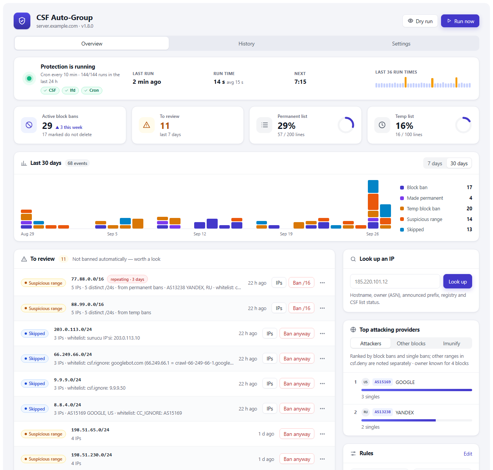
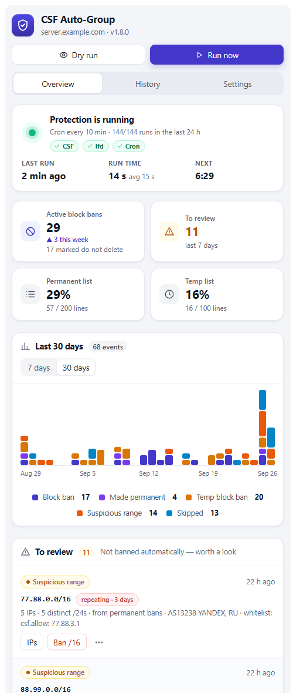
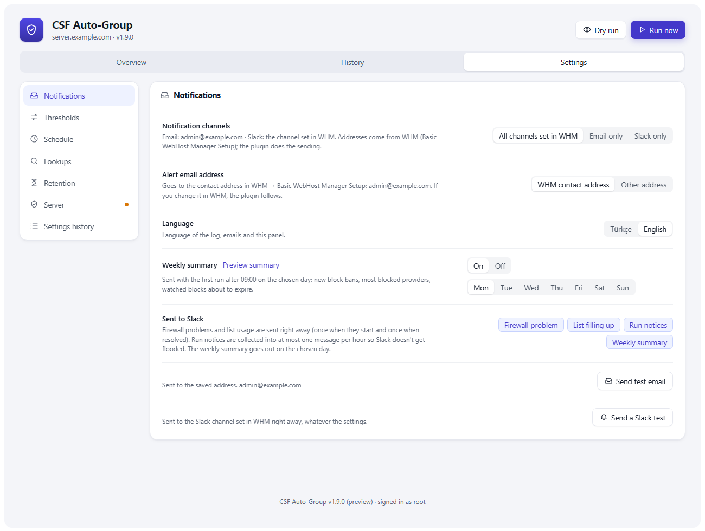
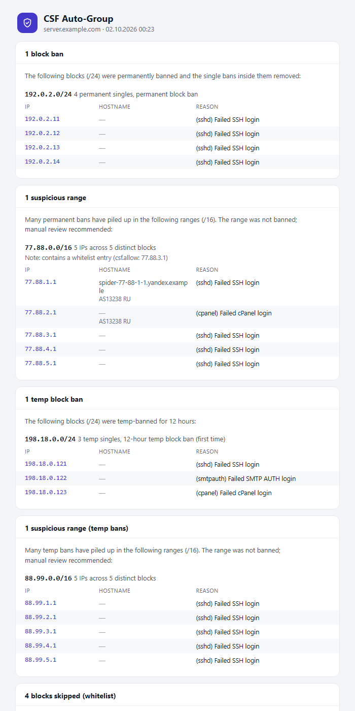

# CSF Auto-Group

**A WHM plugin for ConfigServer Security & Firewall (CSF)** that turns a
scatter of single-IP bans into subnet bans, and gives you one page to see
what your firewall is dealing with and act on it.

Most floods come from the same neighbourhood. When 3–5 already-banned IPs pile
up in a single `/24`, the rest of that range is almost always the same offender
still coming. CSF Auto-Group bans the **whole `/24`** and drops the singles, so
the violation is blocked before you have to touch anything. A range that comes back
is escalated to a **permanent** ban. Wider ranges are only flagged for review,
never auto-banned: first the range the owner announces (`/17`–`/23`), and the
`/16` only when the bans spread over more than one of those ranges.



- **Automatic** — a cron job does the grouping every few minutes; the plugin is
  where you watch it and step in.
- **Who is it?** — every block and IP comes with its owner (ASN, organisation,
  country) and hostname, in the page and in alert emails.
- **Safe by default** — never bans a range that touches any CSF allow list, and
  every manual action asks for confirmation.
- **Email and Slack** — one HTML email per run with everything it did (block
  bans, suspicious networks, skips, limit and firewall alerts), plus Slack
  messages. Both addresses come from WHM; nothing arrives twice.
- **Watches the firewall itself** — shows whether CSF and LFD are working and
  alerts you if one of them stops.
- **English / Türkçe** — the plugin, logs and emails.
- **Works on phones** — the page adapts to small screens.

[Changelog](CHANGELOG.md) · [roadmap](ROADMAP.md) · root-only WHM plugin on cPanel servers. On servers without
cPanel the same engine runs from cron and the command line
([details](#without-cpanel)).

**Terms used everywhere** (plugin, emails, log): a *single* is one banned IP, a
*block* is a `/24` (banned automatically), an *announced range* is the `/17`–`/23`
its owner announces on the internet, a *network* is a `/16` (ranges and networks
are never banned automatically, only flagged as *suspicious*; you can ban them by hand), a *provider* is an ASN.

---

## ⚠️ Read this first

CSF Auto-Group **modifies your firewall**: it bans entire `/24` subnets (256
addresses). A threshold that's too low, or a legitimate visitor whose IP falls in
a banned `/24`, can lock people out.

- **Allow list your own IPs** in `/etc/csf/csf.allow` (CSF allow overrides deny).
  A `/24` that touches any CSF allow list is never banned; see
  [Allow lists](#allow-lists).
- **Start with high thresholds** and watch the page (or
  `/var/log/csf_autogroup.log`) for a few days before trusting it. *Try before
  saving* in the Settings tab shows what new thresholds would do.
- Announced ranges and `/16`s are warn-only by design; only `/24`s are auto-banned.
- **Every `csf -r` leaves a short gap.** While CSF reloads, it flushes its
  rules and rebuilds them; for a few seconds no ban works (more with large
  country / provider lists). This is CSF's behaviour, whoever runs the reload
  (CSF's own UI, a cPanel update, a script). The plugin avoids it where it can:
  the daily update of the allowed services is applied to CSF's allow set
  directly, without a reload. Partial bans, removing a permanent ban and saving
  the provider ban still need `csf -r`; their windows say so.

## Install

```bash
git clone https://github.com/ayzeta/csf-autogroup.git
cd csf-autogroup
sudo bash install.sh
```

The installer asks for the language (`en`/`tr`), alert email (`whm` = the
contact address set in WHM, the default) and cron interval,
writes `config.env`, installs the root cron job and, on cPanel, the plugin under
**WHM → Plugins → CSF Auto-Group**. Re-run it any time.

It also installs a short command, `csf-autogroup`, for the usual jobs:

```bash
csf-autogroup update        # pull from GitHub if it is ahead, then reinstall
csf-autogroup check         # only tell whether an update is available
csf-autogroup reinstall     # reinstall the current version
csf-autogroup status        # current state (same data as the plugin page)
csf-autogroup lookup 1.2.3.4
csf-autogroup run           # one run now (dry-run: one that changes nothing)
csf-autogroup log           # follow the log
csf-autogroup version
```

It lives in `/usr/sbin`, next to CSF's own `csf`, so `sudo csf-autogroup …`
works too.

Only `root` and WHM accounts with the `all` privilege can open the plugin.
Resellers can't.

## Updating

When GitHub has a newer version, the plugin shows a banner: **Update** runs
`update.sh` and **Reload page** loads the new version. The page checks on its
own every half hour while it is open; opening **Settings → Server** asks
GitHub again if the last answer is older than two minutes, and **Check for
updates** asks right away. The weekly summary email also mentions a new
version. From SSH:

```bash
sudo csf-autogroup update
```

(`sudo bash update.sh` in the repository does the same.) It pulls **only if GitHub is ahead**, then reinstalls with your saved
settings, with no prompts. `config.env` is left untouched.

## The plugin



### Overview

- **Status** — whether protection is running, when the last run was and how long
  it took, a countdown to the next run and the durations of the last 36 runs
  (a run's tooltip names what made it longer: lists refreshed, the Imunify360 list fetched, `csf -r`, lfd
  restarted, and the steps that took longer than two seconds), plus three markers: **CSF** (rules loaded, not disabled, not in testing mode),
  **LFD** (running) and **Cron** (runs on time). Turns dark orange (serious) when
  any of them has a problem. Coming back to a tab that was hidden for a while, the run times
  show *updating…* until the new status arrives, never the old numbers.
- **Summary cards** — active block bans, items to review, and how full CSF's
  permanent and temp lists are, each with its change over the chosen period (the
  list cards show it once there is a run record from the start of the period).
  One selector above the cards (7 or 30 days) sets the cards and the chart.
  The number in a list card jumps to that list.
- **Activity** — a daily chart of block bans, blocks made permanent, temp block
  bans, suspicious networks and allow list skips, for the chosen period. Hover a day
  for its breakdown; click a total to open History filtered to that kind and period.
- **Provider card** — every AS badge opens it: CSF provider ban state,
  violations, offending IPs and **Measure impact**.
- **Colors** — colour is used for two things only, the same everywhere (badges,
  icons, chart, emails). The *state* of an address: red filled = blocked
  (permanent or timed; red only ever means blocked), red outline = partly
  blocked, green = allowed, plain = not banned. The *importance* of a finding,
  detection or health problem: amber = attention, dark orange filled = serious.
  Actions (ban, remove, allow, mute, settings) and routine events carry no
  colour; indigo marks only things to click. *Terms* has a *Colours* section.
- **Needs review** — suspicious ranges, suspicious networks and allow-list-skipped blocks from the review
  period (*Days kept in the list*, `REVIEW_DAYS`, default 7 days), as a table: why it was flagged (how many IPs hit which services),
  owner, when, and the narrowest ban that would do; clicking the IP count lists
  every IP's hostname, owner and ban reason, with what it tried in the review
  period when the logs show it: mail accounts, SSH users, FTP accounts,
  cPanel / WHM / Webmail logins, web password users, and the sites and
  addresses ModSecurity blocked (for a ModSecurity ban, only that rule's).
  Only the lines lfd itself counts are read, from the log files set in
  `csf.conf`. An lfd repeat ban (PERMBLOCK) says why it became
  permanent — how many temp bans in what time — and the service of the earlier
  temp ban when the ban history still has it (or the trigger on the PERMBLOCK line). A range whose violations a provider ban
  or rented-server list already closes is left out. A network flagged on 3 or
  more separate days is marked *repeating* and moves to the top.
  It also lists offending IPs lfd can not stop, read from the lfd logs of the review
  period (*Days kept in the list*, default 7 days): an address in `csf.allow` is still banned by lfd (with CSF's default
  `IGNORE_ALLOW = "0"`) but the ban does not work (*Ban not working*; the same when
  the allow came after the ban); with `IGNORE_ALLOW = "1"` lfd does not ban it
  (*lfd ignored*); in `csf.ignore` / `csf.rignore` (or `GLOBAL_IGNORE`, `CC_IGNORE`,
  `RELAYHOSTS`) lfd does not ban it either (*Ignored*; `csf -d` refuses only
  addresses in `csf.ignore`, and a ban on the block cuts it). An advanced allow line (`tcp|in|d=22|s=…`) opens one
  direction only. A permanent ban blocks both directions (unless
  `LF_BLOCKINONLY = "1"`), and so do lfd's temp bans unless `LF_SELECT` is on and `LF_TRIGGER` is off,
  so the replies are dropped and the ban still works. The exceptions are a
  matching line for the other direction (`tcp|out|s=22|d=…`) and a ban that
  blocks incoming traffic only. Each row names the allow or ignore entry behind it,
  with the comment you wrote on that line (`1.2.3.4 # office`); an ignore that
  lfd took from `CC_IGNORE`, `RELAYHOSTS` or a reverse-DNS match in
  `csf.rignore` is traced the way lfd traces it. Failed logins coming from the
  server's own address (lfd never bans those) show as *Server's IP*, with
  the accounts tried from inside the server (mail, SSH, FTP, cPanel…) when the
  logs show them. *Flagged* on these rows is the first record in the
  review window; the note carries the last record and its time. Several
  offending IPs from one allow entry, block or network are grouped like normal bans.
  A ban on an address allowed on all ports does not work (CSF applies allows
  first, and `csf -td` writes temp bans without checking them), so it is not
  counted anywhere: not toward block or network thresholds, the threshold
  preview in Settings, or the IP card's distance to the threshold.
  A partial ban whose open services keep being hit shows as *Open service*
  (counting the IPs that hit the open services after the ban, within the review period).
  An IP that lfd banned for a service a ban already closes (a range ban, a
  partial ban, a provider or country ban, a rented-server list) shows as
  *Violation under a ban*: one row per range for range bans, one row per IP
  for the wider ones, naming the ban that closes the service and since when.
  It also names the cause when one is found: CSF was reloaded within lfd's
  counting window (`LF_INTERVAL`) before the ban, by the plugin or by hand
  (`csf -r`, `csf -ra`; the firewall is open for a few seconds while it
  reloads, and the rented-server rule cuts new connections only, so a
  connection opened meanwhile stays up), or the site the IP hit is behind a
  CDN (the firewall sees the CDN, not the visitor).
  Every row says the latest date it drops off the list by itself if nothing new comes:
  the review period (*Days kept in the list*, default 7 days) after its last attempt,
  warning or violation. Rows are re-checked against today's data and drop earlier
  when they no longer apply. To silence a row before that, use Mute.
- **Active range bans** — a sortable, paged table with each block's owner,
  searchable by CIDR, AS number or organisation. Filters show their counts.
  Watched blocks that reached the temp threshold again are tagged *came back,
  permanent*; temp block bans show their time left. **⋯ → IPs** lists the IPs
  and ban reasons behind any block (from the event log). The
  *Old* filter lists automatic block bans older than the old-block limit (default 365
  days), except ones marked `do not delete` and ones still being tried, with a button
  to remove them all.
- **Watched** — `/24`s that got a temp block ban, or whose permanent ban was removed
  outside the plugin (CSF's list limit, by hand). If, within the watch period,
  as many of its IPs as the temp threshold are temp-banned at the same time (temp
  bans that come and go one by one do not add up), or the block's permanent
  singles reach the block threshold, it becomes permanent + `do not delete`. Sorted by days left; **⋯ → IPs** shows the IPs
  and reasons behind the temp block ban.
- **History** (its own tab) — every ban, promotion, skip, warning and manual
  action, and once a day the findings in Needs review that are otherwise
  recomputed from the logs (violations from allowed IPs, open services,
  violations under a ban), so
  they stay after the review row is gone; back to the start of the event log:
  20 per page, like the other lists; the last page's **›** loads older entries
  from the event log. Work from before the event log existed is
  filled in from the log. Click an address to open its IP card, or a range
  (/16, /24) to open its range card: whether the range itself is banned, which
  services hit are still open for it, and every IP in it with its state now.
  Settings changes are listed under Settings → Settings history.
- **Suggestions where decisions are made** — the ban window suggests a partial
  ban when violations hit only one or two services; the remove window shows when
  and why the ban was added (and, for partial bans, violations on other services
  since then); the IP card has three parts: *This IP* (result, its own ban,
  allow list, ban history and what the address tried in each service,
  *Attempts*, and **Measure impact**: the last 24 hours of web requests from
  this address, as for a provider; if the address is banned it shows whether
  requests still got through after the ban; the range card has the same
  section), *Wider levels* (one row each for the block, announced range,
  network, country, provider and rented-server list, with its state, how far it
  is from its threshold and its ban button) and *Who*;
  changing a threshold shows its effect on the current entries; suspicious
  networks show the services hit.
- **One answer for "is this address blocked now"** — the IP card (including its
  block, announced range and network rows), the range card, the lists, the
  History menus, **Measure impact** and the rented-list / provider details all read the
  same state record, computed in one place in the engine from everything that
  can block or allow an address: `csf.deny` (single IPs, ranges, port lines),
  `csf.tempban` (a line with ports is a partial ban), country and provider bans
  (`CC_DENY` blocks everything, `CC_DENY_PORTS` only its ports), rented-server
  lists with their rule, CSF block lists, the allow lists (an allow comes before
  any ban, so an allowed and banned address is *allowed* and the ban is shown as
  not working), watched blocks and muting. Imunify360 is read from the rules it
  has actually installed, not from its settings, so every way of running it
  alongside CSF is covered: an address in a set whose rule returns to CSF is
  neither allowed nor blocked, an accept for all ports is an allow, a drop is a
  block, and accepting only the WebShield ports before a drop (grey list,
  CAPTCHA) is a partial block — the address can only reach the verification
  page.
- **History actions** — every row has a **⋯** menu with what can be done with
  that item *now* (ban, change, remove, mute, show in Overview, IP card), and
  the newest row of each item says its current state ("banned now", "in To
  review", "no longer banned").
- **Look up an IP** — hostname (forward-confirmed), owner, announced prefix,
  registry, and **every** level at which CSF blocks it: the single ban, the
  covering `/24`, `/16` or other range (with its state, date and main ban
  reason), port-limited `csf.deny` rules for that address, and `CC_DENY` /
  `CC_DENY_PORTS` when its country or ASN is listed there. Also which list
  allow lists it (port-only `csf.allow` rules are shown with their ports), with
  links to bgp.he.net and AbuseIPDB, and buttons to ban its `/24` or `/16`.
  Recently viewed IPs stay one click away. A range (`1.2.3.0/24`) opens the
  range card instead: the result and every action (ban, narrower range,
  remove, mute) at the top, then one table of the IPs in the range (current
  singles, temp bans, offenders, and the IPs a ban or watch rests on) with
  their state now (permanent, temp with time left, not banned) and reason.
- **Inside a wider ban** — a block inside a banned `/16` (or any wider range) is
  tagged *inside /16* in Active range bans and Watched, and listed under
  *Bans no longer needed* in the Providers tab.
- **Ban announced range** — the IP card offers to ban the range the IP's owner
  announces, from /8 to /23 (a /16 is the network ban). Between /17 and /23 it
  is narrower than the /16 and the card shows how far it is from the
  suspicious-range threshold; wider than /16 it covers several networks of
  the same owner and is still narrower than a provider ban. Suspicious-range
  warnings stay at /17–/23.
- **Most blocked providers** (by ASN) — three tabs:
  - *Violations* — ranked by block bans and single bans, with each provider's most
    common ban reason, the services hit (web, mail, SSH…) with their
    counts, and when the last violation was. A provider with 5+ block bans gets a suggestion to add
    it to the provider ban. A provider partly inside a rented-server list is
    tagged with how much of it is already closed there.
  - *Added by hand* — ranges in `csf.deny` added outside CSF Auto-Group.
  - *Imunify360* (only with Imunify360) — providers in Imunify360's **own** block
    list on this server, with the block reasons. Read-only.
- **Banned providers** — its own card below: providers closed by a provider
  ban or fully covered by a rented-server list, with how they are closed and
  whether CSF has loaded their ranges; they are left out of the rankings above
  (and the weekly summary's). A provider banned with the port list only comes
  back to *Violations* while violations continue on services that list leaves open.

  Each list shows the first 5 with the total in its header; *More* and
  *Show all* open the rest, *Collapse* closes them again.
- **Terms** (header button) — a short glossary of the words the panel uses
  (single, block, watched, partial, provider ban, rented servers…).
- **Since your last visit** — what happened since you last opened the page; new
  rows carry a dot, and so does a *Needs review* row that got a new record
  (its *Flagged* time stays the first record).

### Actions

Every action asks for confirmation. Risky ones (banning a `/16`, overriding a
allow list, removing a `do not delete` block) make you type the target.

A single IP can be banned from its IP card (**Ban IP**): *Everything*, permanent
or temporary (1 hour to 7 days, both directions, CSF's temp list), or
*Selected services* (a permanent partial line). It is refused for this
server's own IP, an IP that is already banned or inside a permanent range ban,
and a allowed IP needs a confirmation. An IP with its own ban, whoever set
it, gets **Remove ban**.

An IP can also be allowed from its IP card (Allow list → **Allow…**): with no
end (a csf.allow line, with an optional note) or for 1 hour to 7 days (CSF's
temporary allows, both directions). The allow comes before every ban; the
rented-server lists and the ban guard pick it up right away. With no end, CSF
deletes the IP's permanent single ban from csf.deny (a `do not delete` line
stays but no longer works); a timed allow leaves csf.deny alone, so that ban
works again when the allow ends. **Remove allow** deletes the IP's own csf.allow
line or temporary allow; allows from included files are removed in those files.

Range bans (`/24`, `/16`, announced range) can be timed too (*Everything*, 1
hour to 7 days). A timed ban does not remove what is inside the range, so the
range is back to how it was when the time is up; it is listed as a manual ban
with the time left.

Manual bans run the same allow list checks as automatic ones (for a `/16`, the
blocks inside with single bans are checked too), including Imunify360's own
whitelist. Manual `/24` and `/16` bans open the same window: it first lists what is inside
the range (CSF Auto-Group block bans, single bans, temp bans, watched blocks,
other ranges and port-limited rules), shows any allow list overlap, and offers
**Remove covered entries** (on by default): every permanent entry inside the
range (block bans, single bans, other ranges, `do not delete` ones included)
leaves the permanent list and the temp bans leave the temp list; the window
shows how many lines each list frees and what happens to each row. Watching
ends for blocks inside when covered entries are removed (with the option off it
goes on); port-limited rules are left alone. The
removed permanent entries are saved: when you later remove the ban, **Restore
the N entries removed when this ban was added** puts them back exactly as they
were (comments, dates and `do not delete` markers). Temp bans are not restored,
they would have expired anyway. The removed IPs and their ban reasons also stay
with the new ban (**⋯ → IPs**). A range containing one of this server's own IPs
can't be banned at all.

Removing an **automatic permanent** block ban works the same way: **Restore the N single
bans this ban rests on** (on by default) puts the IPs it replaced back in the
permanent list as permanent single bans dated today, with their original reasons,
so those IPs are not fully unblocked with the block. A temp block ban is only lifted
(`csf -tr`); the single bans inside are left as they are and there is nothing to restore. Restored singles count towards the block threshold
like any single ban: if they meet it, the block is banned again on the next
run (the dialog says so), otherwise when new bans complete it. IPs already banned, covered by another range ban or in the allow list are
skipped. Old block bans removed automatically are not restored, since that
removal is there to free space in the list.

**What to block** — the same window lets you choose:

- **Everything** — the range is cut in both directions (a normal CSF ban).
- **Selected services** — only connections *from* the range to the services you
  pick are blocked (Web, SSH on this server's real SSH port, FTP, cPanel · WHM ·
  Webmail, mail sending (SMTP: the ports Exim listens on, e.g. 25, 465, 587
  and any extra port added in WHM), mail reading (IMAP, POP3: the ports
  Dovecot listens on), DNS, plus any
  other ports or ranges such as `8080, 30000-35000`; add `/udp` for UDP, e.g.
  `443/udp`, a port without a suffix is TCP). Everything else stays open, and connections from this
  server to the range are not affected. Web includes UDP 443 (HTTP/3) and DNS
  includes UDP 53. It is one `csf.deny` line (split per 15
  ports), shown as *partial* in Active range bans; it doesn't cover the range, so
  nothing inside is removed and watching continues.
- **Everything except** — a full ban, but the services you pick stay open,
  including outgoing mail and outgoing web (this server calling APIs, backups or
  updates in that range). CSF checks bans before "established connection" replies,
  so each service gets a two-way allow rule in `csf.allow` (request and reply);
  for FTP the passive port range is added too (read from pure-ftpd / proftpd, or
  CSF's `TCP_IN`). The rules are marked and removed with the ban, and are never
  counted as allow list entries.

Each service button shows how many IPs of the range hit it, read from the
ban reasons LFD wrote (`(sshd)` → SSH, `(smtpauth)` / `(imapd)` → mail client,
ModSecurity and web rules → Web, port scans → "Everything" is suggested).
**Selected services** preselects only the services hit; **Everything
except** preselects nothing and warns when an service hit is kept open.
A **Blocked / Stays open** summary under the choices says in plain words what
the selection does. The window also points out services that depend on each other: mail may need DNS when
this server also hosts the DNS for its domains (other mail servers look up MX,
SPF, DKIM and DMARC records), web may need DNS for crawlers and visitors that
resolve through resolvers in that range, and cPanel addresses like
`cpanel.example.com` go through the web port. **⋯ → Change ban** reopens the
window for a CSF Auto-Group ban with its current choice: change the open
services, switch a full ban to a partial one (the entries it removed are
restored, since a partial ban doesn't cover the range) or a partial ban to a
full one.

| Button | Does |
|--------|------|
| Ban network (/16) | permanent `/16` ban, added as `do not delete`: from Needs review, **⋯** in Active range bans and Watched, and the IP card |
| Ban block (/24) | permanent `/24` ban from the IP card |
| Change ban | change what a CSF Auto-Group ban blocks (everything / selected services / everything except) |
| Ban anyway | ban a allow-list-skipped `/24` (overrides the allow list) |
| Make permanent | make a watched `/24` permanent right away |
| Stop watching | forget a watched `/24` (it is then treated like any unwatched block) |
| Restart watch | start a watched `/24`'s watch period again from today (**⋯** in Watched and the IP card) |
| Remove | lift a block ban (`do not delete` blocks too; `csf.deny` is backed up first) |
| Remove old ones | on the *Old* filter: remove every block ban older than the old-block limit |
| Mute | hide an item from review for 7/30/90 days or indefinitely (its emails, Slack messages and History records stop too, also for addresses inside a muted range), from a Needs review row's **⋯** or the IP card; *Muted* and the IP card show who muted it and when; change the duration or unmute under *Muted*, unmute from the IP card too. Muting does not touch bans or lfd; "ignore" in the panel only ever means CSF's own ignore (csf.ignore, IGNORE_ALLOW) |
| IPs | a block's IPs and ban reasons, as recorded in the event log |
| Dry run | show the ban and notification decisions a run would make; changes nothing, sends nothing (list refreshes are skipped; Needs review notices are shown but not recorded) |
| Run now | run immediately instead of waiting for cron |

Manual actions are logged as `MANUAL (user): …` and appear on the History tab.

### Settings

The same settings as `config.env`, with validation, in sections ordered by
weight (general, ban rules, notifications, sources and refresh, server,
settings history); inside a section every group of settings is a card of
its own:

- **General** — running / paused, how often the cron run starts (every 5 / 10
  / 15 / 30 minutes or hourly), and the language of the log, the mails and
  the panel. More frequent runs ban a block that crosses a threshold sooner
  (at most one run later); they do not change what is counted (temp bans that
  start and end between two runs are counted on the next run). Every run, even
  a quiet one, adds a summary line to the log and a run record to History.
- **Ban rules** — block ban (`/24`): permanent singles needed, the count that
  makes it *kept* (`do not delete`) and the temp block ban; suspicious network
  (`/16`, permanent and temp single bans counted together); the permanent
  single window (default 90 days, see below); the watch period
  (a temp-banned block is banned for good if, within it, the temp threshold is
  reached again at the same time or its permanent singles reach the block
  threshold); how
  long entries stay in *Needs review*; and the old bans: old-block limit
  (default 365 days), how recent an attempt keeps a block from being old
  (default 30 days), and whether old block bans are removed automatically
  (default off; manual bans are never touched). Old-block removal keeps
  blocks marked "do not delete" and blocks still being tried: a banned
  block's traffic never reaches lfd, so the plugin counts it itself — an
  `ag_hits` ipset with a counter per banned range and one rule at the very
  top of the `mangle` table's `PREROUTING` that only counts (it neither
  blocks nor allows anything). It sits ahead of the rented-server list and
  the ban guard, so attempts they drop are counted too. CSF clears the
  counters on every reload: the plugin reads them before its own reloads, and
  `csfpost.sh` puts the rule back afterwards. Its last attempt shows in the
  state tip.
- **Notifications** — an *Events and channels* table: five kinds of event
  (firewall problem, list filling up, run notices, allowed-IP violations /
  open services / violations under a ban, weekly summary) × two channels (email, Slack), each cell on
  or off. Run notices are the bans, suspicious ranges and networks, skips,
  old-block removal and lists that can't be downloaded (with the reason: the
  HTTP status, a timeout, a DNS or TLS error, a cut-off transfer, a list with
  no usable range, or one that shrank to less than half; the same reason shows
  on the list's box under Providers); the
  allowed-IP violation and open-service records are the allowed / ignored /
  server-IP, open-service and violation-under-a-ban rows of *Needs review*,
  sent once per IP, range or ban per day (an ignored IP only once its failed
  attempts reach lfd's own threshold within `LF_INTERVAL`; a violation under a ban only when
  a new IP shows up) and never for what you muted. Both go by email at the end
  of the run and on Slack collected into at most one message per
  `SLACK_BATCH_MIN` minutes (default 60; a list that can't be downloaded goes
  right away); firewall and list problems go to Slack right away (once when
  they start and once when resolved) and by email once a day while they last. The email address comes from WHM's Basic WebHost
  Manager Setup (or any address you type); the Slack address is the one set
  there, read at send time and never stored by the plugin. The plugin sends
  the HTML emails and Slack messages itself, so nothing arrives twice. *Send
  test email*, *Send a Slack test*, and the day of the **weekly summary**:
  new block bans, the week's review records, providers CSF and Imunify360
  block most, watched blocks about to expire, list usage, run health, and a
  note when a new version is available. Sent with the first run after 09:00
  on the chosen day (default Monday).



- **Sources and refresh** — owner/hostname lookups on or off, DNS timeout and
  how long a block's owner is kept before it is looked up again (default 30
  days); the hour the lists are refreshed (default 04:00, server time: the
  first run after it downloads them, so that run takes longer); how often the
  rented-server and allowed-service lists are downloaded again and after how
  many failed days it is reported; how old CSF's ASN data
  may get; how often Imunify360's lists (block list and whitelist) are read
  (default 60 minutes). The
  Providers cards link here.
- **Server** — version and update, CSF's list limits (read-only, with how full
  each list is), a **Server requirements** card listing the tools CSF
  Auto-Group uses (CSF, cron, mail, dig/host, logrotate, flock, timeout, git,
  Imunify360, ModSecurity hit log, sqlite3) and what happens when one is
  missing, **Record keeping**: how many days History (bans, warnings, manual
  actions, setting changes; default 180), the run records (default 31) and the
  ban history (default 90, at least the permanent single window) are kept, with
  how many there are now and how far back they go; and the log file: rotated by the
  system's logrotate (`/etc/logrotate.d/csf_autogroup`, written from these
  settings; default 1 MB, 5 compressed archives); where logrotate is missing,
  lines older than a number of days (default 30) are removed instead. A run
  where nothing happened leaves a single line in the log.

*Try before saving* runs a dry run with the unsaved thresholds. Saving writes
`config.env` (previous file kept as `config.env.bak`), updates the crontab and
logs each change as `SETTING (user): KEY: old → new`. CSF's own list limits
(`DENY_IP_LIMIT`, `DENY_TEMP_IP_LIMIT`) are shown read-only with how full each list is; change them in CSF.

## How grouping works

The escalation ladder: a few bad singles in a block turn into a block ban, and a
block that comes back turns into a permanent one.

| Trigger | Action |
|--------|--------|
| `/24` with **≥3** permanent single bans | permanently ban the `/24`, remove the singles |
| `/24` with **≥5** permanent singles when it is banned (or a watched `/24`) | ban `/24` + `do not delete` |
| announced range (`/17`–`/23`, from the owner cache) with **≥4** singles across **≥2** `/24`s (permanent and temp counted together, each IP once) | flag as suspicious range by email, suggest banning that range, no auto-ban; reported again only when a new IP comes in (at most once a day). With a partial ban on the range, only bans after it that hit a service it leaves open count |
| `/16` with **≥5** singles of the same owner across **≥2** sub-units (announced ranges; a `/24` when the range is unknown, `/24` or `/16` and wider; banned blocks count as sub-units, their singles do not) | flag as suspicious network by email, no auto-ban, same repeat rules. The singles of an announced range that is over its own threshold are reported with that range and not counted again here; bans of different owners in the same `/16` are not added together |
| `/24` with **≥3** temp bans at the same time (first time) | temp-ban the `/24` for 12h, watch it |
| watched `/24` with **≥3** temp bans at the same time again, or **≥3** permanent singles | permanent ban + `do not delete` |
| plugin's block ban left `csf.deny` without the plugin (CSF drops the oldest unmarked lines when `DENY_IP_LIMIT` is reached) | watch the `/24`, alert by email and in History |
| deny list **≥80%** of its limit | alert: email once a day; Slack once when it starts and once when resolved |
| CSF disabled / in testing mode / rules not loaded, or LFD not running | alert: email once a day; Slack once when it starts and once when resolved |
| block ban older than the old-block limit (optional) | remove it |

**What the thresholds count.** Permanent singles count if their date in
`csf.deny` (lfd and `csf -d` write it at the end of the line) is within the
*permanent single window* (default 90 days); older ones stay banned in CSF but
do not count toward the block (`/24`) and network (`/16`) thresholds or the
provider ranking, and when the block is banned they are removed with the
others. Lines without a date count. Temp singles count for as long as each ban
lasts: every run looks at the temp bans since the previous run and takes the
largest number in a block that were banned at the same moment (a temp ban lifted
before it expires counts only until the run before its removal). So the count
does not depend on how often the run starts, and each ban counts for the time
lfd gave it, whatever `LF_TRIGGER_PERM` / `LF_*_PERM` / `CT_BLOCK_TIME` say on
that server. The first run after installing or updating starts counting from
that moment.

**Ban history.** Every run records the single bans since the previous run in
`/var/lib/csf_autogroup/banlog` — from lfd's log (`*Blocked in csf* for N secs`
for temp bans, without a duration for permanent ones), the temp list (manual
`csf -td` bans are not logged by lfd) and `csf.deny` — with when, how long and
why. The record stays after the ban ends (a temp ban expires, CSF drops an old
line when the list is full, lfd's log rotates): a ban that leaves the list
before its time is recorded as ending at that run. It is kept for the ban
history period (default 90 days, at least the permanent single window). The
temp threshold, the provider ranking, the service behind a PERMBLOCK, the IP
card's *Ban history* and the range card's IP table all read it. The first run
fills it from lfd's log archives.

Temp bans already covered by a permanent block are cleared, watch records expire
after the watch period (`SAYAC_RETENTION_DAYS`, default 180 days), and the log is capped. Singles marked
`do not delete` are never removed. A `/24` already covered by a broader block in
`csf.deny` (a `/22`, `/16`, …) is left alone. Folding singles into ranges also
keeps `csf.deny` from overflowing its line limit.

### Owner info

Each run sends at most one email; its subject sums up the run, e.g.
`CSF Auto-Group: 2 block bans · 1 suspicious network · 1 temp block ban`. Emails
are HTML (cards and tables that also work in desktop Outlook) with a plain-text
part for clients that don't show HTML.



The plain-text part looks like this:

```
185.220.101.0/24 -> 4 permanent singles, permanent block ban
   Owner: AS60729 ARTIKEL10, DE
   - 185.220.101.12   berlin01.tor-exit.artikel10.org  (sshd) Failed SSH login
   - 185.220.101.47   tor-exit-47.artikel10.org  (smtpauth) Failed SMTP AUTH login
```

- **Owner** — ASN and organisation from CSF's own ASN data (`ip2asn`, the data
  `CC_DENY` uses for `ASnnnn`), country from CSF's own IP location data (what
  `CC_DENY` and `CC_IGNORE` use), so the provider and country you see are the ones
  CSF acts on. The announced range (BGP prefix) comes from
  [Team Cymru's](https://www.team-cymru.com/ip-asn-mapping) free DNS service (no
  account or API key); when CSF has no data for a field, that field comes from
  Team Cymru too. The IP card names the source of each. If the server's DNS
  resolver cannot answer Team Cymru (for example it returns `SERVFAIL`), that is
  not taken as "no data": the cached range and owner are kept and shown as an
  earlier lookup, the IP card says why the range could not be asked, and after
  three failures in a run only the Team Cymru lookups pause (reverse DNS goes
  on). Cached for
  `OWNER_TTL_DAYS` (default 30 days); after that a run looks it up again (a
  limited number of blocks per run) and the old info is used until then.
- **Hostname** — each IP's reverse DNS.
- **Reason** — why LFD banned it, from the ban's own comment. ModSecurity bans
  show the rule's message (e.g. `ModSecurity 1302: WP LOGIN VIEW RATE LIMIT…`),
  read from cPanel's ModSecurity hit log with `sqlite3`, or from the rule file
  named in the ModSecurity log when that isn't available.

Lookups are plain DNS queries (`dig` or `host`) with a short timeout. Set
`LOOKUP=0` to turn them off: cached owners are still used, new blocks get none
(suspicious range and network counts go by owner and announced range), and
`csf.rignore` can't be checked, so blocks it would protect are banned too.
`CC_IGNORE` and `CC_ALLOW` don't need DNS: they are checked against CSF's own
data (see the table below). Alert emails end with a link to the plugin
(`https://server:2087/ → Plugins → CSF Auto-Group`).

### Allow lists

Before banning a `/24` (permanent or temp), CSF Auto-Group checks it against
every list CSF uses to say "don't block this". If **any** entry overlaps the
`/24`, nothing is banned and you get one email a day naming the entry:

| Source | What is checked |
|--------|-----------------|
| `csf.allow` (+ `Include`) | IPs, CIDRs, hostnames, and port-only rules (`tcp\|in\|d=2083\|s=IP`) for a specific address or range; rules that open a port to everyone (`s=0.0.0.0/0`, anything wider than `/8`) are port rules, not allow list entries |
| `csf.ignore` (+ `Include`) | IPs and CIDRs |
| `GLOBAL_ALLOW`, `GLOBAL_IGNORE`, `DYNDNS`, temp allows (`csf -ta`) | CSF's cached lists in `/var/lib/csf` |
| Server's own IPs | a `/24` containing one of this server's addresses |
| `CC_IGNORE` in `csf.conf` | each banned IP's country code or `ASnnnn`, looked up the way LFD does it (CSF's own `iplookup` and geo data, matched like LFD); like LFD, only while `CC_LOOKUPS` is on |
| `CC_ALLOW` in `csf.conf` | CSF's zone files for those codes (the same data CSF loads into its allow sets); any overlap with the `/24` counts |
| `csf.rignore` | a banned IP whose reverse DNS matches (forward-confirmed, like LFD) |
| Imunify360 whitelist (only with Imunify360) | the server's local whitelist: manual entries and search engine bots Imunify whitelisted; expired entries are ignored, refreshed every `IMUNIFY_REFRESH_MIN` minutes (default 60) |

This matters most for `csf.ignore`: CSF lets `csf.allow` addresses through even
inside a banned range, but `csf.ignore` only stops LFD, so a `/24` ban would
block those addresses. If a check can't be completed because DNS isn't
answering, the block is retried on the next run instead of being banned.

### CSF blocklists

CSF can load third-party lists of bad addresses itself (`/etc/csf/csf.blocklists`:
Spamhaus DROP, DShield, Tor exit nodes, Blocklist.de…). lfd downloads each enabled
list into `/var/lib/csf/csf.block.NAME` and drops incoming traffic from its
addresses on every port; an address on the allow list still passes. An address
in an enabled list shows as *blocklist NAME* in the IP card and in *Measure
impact*, and a later lfd ban on such an address counts as a *Violation under a
ban*, not towards the thresholds. A list that was disabled in `csf.blocklists`
is not counted, even though CSF leaves its downloaded file on disk.

On the *Providers* tab, CSF blocklists are a protection layer next to rented
servers, provider bans and allowed services: a summary tile at the top (lists
on, addresses loaded, last download) and a card that lists every entry of
`csf.blocklists` with its state, how many addresses are loaded and when it was
last downloaded. A list is turned on or off with the same On / Off switch as the
other layers and saved with the Save bar (the confirmation lists the change):
the plugin removes or adds the `#` at the start of that one line and restarts csf and lfd
(`csf -ra`, a few seconds during which the firewall is open), and the change is
written to the settings history. The plugin never turns a list on by itself,
and it only turns off lists it turned on; a list you enabled by hand is shown
as such and left alone. Once a day, at the refresh hour, the plugin checks
each list's source (number of addresses, HTTP code, private or reserved
ranges) and says in the row when a source is empty, does not open or would
also cut local networks. "Details" opens the same window as for providers:
the offending IPs in the list and Measure impact.

### AbuseIPDB

With an AbuseIPDB API key (Settings → Server → AbuseIPDB; a free account
allows 1,000 checks a day) the IP card asks AbuseIPDB about the address when
you open it and shows its confidence score, how many reports and reporters
it has, the last report and the usage type; the ban window shows the same
line. Answers are cached (24 hours by default), private and local addresses
are never sent, and the runs and list screens never ask, so the daily limit is
only used by cards you open. The score is shown for your decision; the plugin
does not ban on it. The key is stored in its own root-only file (not in
`config.env`), is handed to the engine on standard input, and only its last
four characters appear in the panel, the log and the settings history.

The range card of a `/24` or narrower range has a "Check on AbuseIPDB"
button. It uses AbuseIPDB's block check and lists the addresses in the
range that were reported in the last 30 days, with their score, number of
reports and last report, plus how many there are and the highest score (a
range has no score of its own). A free account has 100 block checks a day,
so the card never asks by itself when it opens; the answer is cached like an
IP's and also shown in the range's ban window. AbuseIPDB's standard plan
checks ranges up to `/24`, so wider ranges show no button. AbuseIPDB has no
check by provider (ASN) or country, so provider and country views have no
AbuseIPDB part. The score is shown as a badge coloured by its value: grey for
0, amber (attention) for 1–49 and dark orange (serious) for 50 and above.

Once a key is saved the card shows it masked (last four characters) with
"Change" and "Remove key", and five settings: `ABUSE_ON` turns lookups off
without removing the key; `ABUSE_CACHE_H` (default 24, 1–168) is how many
hours an answer is kept; `ABUSE_IP_MAX` (default 1000) and `ABUSE_BLK_MAX`
(default 100) are the daily IP and block lookup limits, after which no new
lookup is sent and the card says the limit is reached (the counter resets on
the server's calendar day); `ABUSE_MAX_AGE` (default 90, 1–365) is how many
days of reports count — block lookups use at most 30, the free plan's limit.

### With Imunify360

Imunify360 puts its own chain at the top of `INPUT` and redirects some traffic
to its WebShield ports in the `nat` table, where it is accepted before CSF's
rules. cPanel's plain ports 2082 and 2083 are redirected for every address;
web and the other cPanel ports (80, 443, 2086–2096) only for addresses on its
grey, splash-screen or captcha lists. Bans that look at the port then no longer
match, because the connection now goes to a WebShield port. These are the partial bans (web only), provider and country bans
with the port list (`CC_DENY_PORTS`), and the rented-server lists. A banned
address that passes the WebShield check (a real browser does) could still open
the sites. Full bans (single IPs, blocks, "everything") are not affected: CSF
applies them in both directions and Imunify360 only accepts a connection's
first packet.

The plugin closes this with one chain in the `mangle` table's `PREROUTING`
(`AG_GUARD`, `tools/ban-guard.sh`). That table runs before any redirect, so
the connection still carries the port it was sent to, and Imunify360 has no
rules there to race with (it puts its `INPUT` chain back on top within a
minute, so a rule in `INPUT` loses its place). For new incoming connections
only, it applies CSF's allow list first (the same list as the rented-server
rule: a single-port allow passes only on its port) and then the port bans, TCP
and UDP alike (partial bans in `csf.deny` and `CC_DENY_PORTS_TCP` /
`CC_DENY_PORTS_UDP`). UDP bans are copied whether or not this server's
Imunify360 redirects UDP: where it doesn't, the extra rule changes nothing,
because CSF drops that traffic anyway. Other traffic
and this server's own outgoing connections are not touched. A `csfpost.sh`
line puts it back when CSF restarts, and each run checks that it is still
first. The rented-server lists use the same place (see below).

`bash tools/ban-leak.sh [HOURS]` (read only) checks the web logs of the last
24 hours, or the hours given, for requests that reached the sites while a ban
was in force, layer by layer. Allowed addresses are left out. It also lists the
rules that rewrite or accept traffic before CSF, and the banned addresses that
sit inside an allow list (those bans have no effect). Requests to sites behind
a CDN are listed separately, not as leaks: the firewall sees the CDN, not the
visitor. The report is also saved to `/root/ban-leak-DATE.txt`.

**Sites behind a CDN.** When a site's domain or its www name points to a CDN
(QUIC.cloud, Cloudflare…) or another address instead of this server, its
visitors reach the firewall through the CDN, so a CSF ban can not cut them; the
place to block them is the CDN's panel. `tools/cdn-sites.sh` finds these sites
once a day by DNS (the plugin runs it; `--show` lists them). The web logs don't
say which name a request came to, so if one of a site's names goes through a
CDN, that site's requests are treated as possibly behind it.

## Without cPanel

CSF Auto-Group works on any CSF server. Without cPanel there is no plugin page;
the cron job does the same grouping and sends the same emails, and everything
the page shows is available from the command line:

```bash
./csf_autogroup.sh --status          # same data as the plugin page
./csf_autogroup.sh --dry-run         # what a run would do, changes nothing
./csf_autogroup.sh --lookup 1.2.3.4  # who is this IP?
./csf_autogroup.sh --inside 1.2.0.0/16   # what a manual /16 (or /24) ban would cover
./csf_autogroup.sh --events latest 0 50   # the latest 50 events as JSON (after|before TIME N pages)
./csf_autogroup.sh --digest          # preview the weekly summary
./csf_autogroup.sh --config get      # current settings (--config set KEY=VALUE …)
./csf_autogroup.sh --help
```

Requirements: CSF and a working `sendmail` (HTML emails) or `mail` command
(plain text); `dig` or `host` for lookups. Optional: `sqlite3` (ModSecurity rule
messages in ban reasons) and `curl` (Slack).

### Manual install

```bash
cp config.env.example config.env      # edit ALERT_MAIL, MSG_LANG, thresholds
chmod 700 csf_autogroup.sh
( crontab -l 2>/dev/null; echo '*/10 * * * * /path/to/csf_autogroup.sh >/dev/null 2>&1' ) | crontab -
```

## Configuration

All settings live in `config.env` next to the script (see
[`config.env.example`](config.env.example)) and can be edited from the Settings
tab. Key options:

- `MSG_LANG` — `en` or `tr` (plugin, logs, emails and `csf.deny` comments).
- `ALERT_MAIL` — where alert emails go: `whm` (the contact address set in WHM,
  default) or an email address.
- `IE_FIREWALL`, `IE_LISTFULL`, `IE_RUN`, `IE_REVIEW`, `IE_SVCX`, `IE_DIGEST` —
  which events go by email; `IC_FIREWALL`, `IC_LISTFULL`, `IC_RUN`, `IC_REVIEW`,
  `IC_SVCX`, `IC_DIGEST` — which go to Slack (1 = on, all on by default;
  `*_REVIEW` = allowed-IP violations and open services; `*_SVCX` = combined
  services file problems: Apache rejected the new list or the web server could
  not be reloaded, once per problem); `SLACK_BATCH_MIN` — run notices
  and review records go to Slack at most this often (default 60). `NOTIFY` (`all`, `email`, `slack`)
  is the older master switch and still works; the panel writes `all` and
  uses the per-event keys.
- `THRESHOLD_24`, `THRESHOLD_24_PERMANENT`, `THRESHOLD_16`, `THRESHOLD_TEMP_24` —
  sensitivity.
- `LOOKUP`, `LOOKUP_TIMEOUT` — owner/hostname lookups.

## Uninstall

First turn off **Provider ban**, **Rented servers** and **Allowed services** in
the Providers tab and pause the plugin (Settings → General): that removes what
the plugin added to CSF, including the block counter (`ag_hits`) and the ban
guard (`AG_GUARD`). Without the panel, `bash tools/block-hits.sh --remove` and
`bash tools/ban-guard.sh --remove` remove them.

```bash
crontab -l | grep -v 'csf_autogroup.sh' | crontab -
rm -f /usr/sbin/csf-autogroup
# WHM plugin (cPanel):
/usr/local/cpanel/bin/unregister_appconfig csf_autogroup
rm -rf /usr/local/cpanel/whostmgr/docroot/cgi/csf_autogroup /var/cpanel/csf_autogroup
rm -f /var/cpanel/apps/csf_autogroup.conf /usr/local/cpanel/whostmgr/docroot/addon_plugins/csf_autogroup.svg
rm -f /etc/logrotate.d/csf_autogroup
# optional:
rm -f /var/log/csf_autogroup.log
rm -rf /var/lib/csf_autogroup
```

Existing `/24` bans stay in `csf.deny` until you remove them (`csf -dr <cidr>`).

## Provider ban (experimental)

The **Providers** tab bans a whole provider by its AS number with CSF —
useful when violations come from one cloud spread over hundreds of networks, too
many to ban one by one. Everything is managed from the panel; the wanted state
is kept in `config.env`, and every run makes CSF match it. After a server move,
restoring `config.env` is enough.

- **What to block, per provider (up to 50):** *Port list* (`CC_DENY_PORTS`) or
  *Everything* (`CC_DENY` — this also breaks this server's connections to that
  provider, because CSF applies it before replies). CSF has a single port list
  for `CC_DENY_PORTS`, so it is shared. You pick it as services (Web — TCP 80,
  443 and UDP 443 for HTTP/3 —, SSH, FTP, cPanel, mail, DNS) plus other ports,
  each with a badge for how many IPs from the port-list providers hit it; the
  screen also shows the exact value written to CSF. If those providers hit a
  service the list does not block, the card offers to add it. There is no
  "everything except" choice here: CSF blocks these ports without looking at
  the connection state, so blocking the complement would also drop the replies
  to this server's own connections. If another country or provider there uses
  different ports, the list isn't changed and the screen says why.
- **Most blocked providers** sits next to it: **Ban…** on a row adds the
  provider to the list and measures its impact (nothing is applied until you
  save).
- **Details** on a provider row (and on a rented-server box) opens one window
  for both: whether and how the source is banned now, how many offending IPs
  it has and on which services, a hint on which ports would cut them, and a
  table of those IPs (IP, service, last record, where it was recorded, what
  covers it now). The last 24 hours of web requests (**Measure impact**) are
  read only when asked, because large logs can take a minute.
  `csf_autogroup.sh --src-ips ASnnn` (or `cl:list`) prints the same IP list as JSON.
- **What Measure impact reads, and where it can fall short** — the cPanel site
  logs (domlogs) of the last 24 hours. cPanel's statistics run (`cycle_hours`
  in `cpanel.config`, about once a day at a time that drifts) empties each site
  log and appends its lines to the user's monthly archive
  (`~/logs/<log name>-<Mon>-<YYYY>.gz`, one gzip part per run). When a log
  starts after the window, the missing hours are read from that archive: only
  the parts written inside the window, never the whole month. Before any line
  is used, the archive is checked:
  - it belongs to the owner of the log;
  - the part headers match the archive's own first part (look-alike bytes inside
    compressed data are skipped);
  - it decompresses without error from that point;
  - every line is a log line.

  If any check fails, the archive is not used. The same goes when archiving is
  turned off for the user, or the previous month's archive is missing. In each
  of these cases the result says how many sites could not be measured for the
  full 24 hours, the shortest coverage, and why.

  Log times are read with each line's own time-zone offset, so a web server
  logging in another zone does not shift the window.

  Requests count as "behind a CDN" (a ban on the visitor cannot cut them) only
  for sites whose response headers show a CDN (Cloudflare, QUIC.cloud, Sucuri,
  …). A site whose name points to another server that is not a CDN is hosted
  elsewhere, so requests that do reach this server come directly and a ban cuts
  them. When the web server logs the visitor's address from the proxy header
  (LiteSpeed's *Use Client IP in Header*, Apache's `mod_remoteip`), a single
  request cannot be told apart, so the whole CDN site counts as "may come
  through the CDN".

  Only web requests are measured.
- **Measure impact** before saving: the last 24 hours of web logs, for that
  provider — response codes, successful requests, successful POSTs (payment
  notifications, webhooks), examples of failed requests (403, 404, 5xx…: code,
  site, request and an example IP) and non-browser clients, by site. Requests
  are split into sites behind a CDN (a ban does not affect them), allowed
  services, addresses an active rented-server list already closes, and the rest.
  For allowed services the responses they got are listed with the most
  frequent refused requests (which page gave Googlebot a 403, for instance);
  those come from the site or ModSecurity, not from a ban. Allowed addresses
  include your own full allows in `csf.allow` (office, customers).
  - **Crawl signs** for the open addresses: clients that name themselves as
    crawlers, one user agent spread over many IPs, IPs visiting several sites,
    IPs that ask only for pages (no css, js or images) and requests to form and
    API endpoints. When most successful requests carry these signs, the screen
    suggests a ModSecurity rule for the crawler's user agent, which is more
    targeted than banning the whole provider.
  - Every listed IP shows what covers it right now, the same as its IP card:
    single, temp and range bans, a watched block, a provider or country ban
    (with *port list only* or *everything*), an active rented-server list and
    port lines in `csf.deny`.
  - Once the provider is banned, requests from open addresses after the ban are
    counted; the first 2 minutes after saving (while CSF and lfd reload) are not
    counted as "the ban did not stop them", and the latest requests are listed
    with time, IP, site and code.
- After saving, the setting is written to CSF right away and lfd is restarted
  (lfd fills the address sets); the screen shows how many ranges are loaded.
  Turning it off removes only what the plugin added.
- A single ban is judged on its own against every ban that already covers
  its address (a range ban, a partial ban, a banned provider, a country ban in
  CSF or an active rented-server list). The plugin keeps a ledger of when it
  first saw each of these (`covers` in its state directory; a ban that was
  already there when the plugin was updated starts at the update). A single
  banned before the covering ban, or within lfd's counting window after it
  (`LF_INTERVAL`), is left out of the thresholds silently; one banned later for
  a service the covering ban leaves open counts as usual (a Web-only ban
  covers web violations, not SSH ones); one banned later for a service it
  closes does not count and is recorded as a *Violation under a ban*.
- Block bans already inside a banned provider stay in `csf.deny`; they are
  marked *inside a provider ban* (checked against the ranges CSF loaded) and
  the Providers tab lists them under *Bans no longer needed* and can remove them.
- The weekly summary lists the banned providers, what is blocked and how many
  ranges CSF loaded.
- **CSF's ASN data:** lfd downloads `/var/lib/csf/Geo/ip2asn-combined.tsv` only
  when it is missing, so the addresses go stale; the plugin has lfd download it
  again when it is older than the period set in the card (default 25 days),
  checked on every run while CSF has a provider ban, so it is refreshed on the first
  run after the period is up (lfd is restarted for it; if lfd has not downloaded it
  within 12 hours, the old file is put back and it is tried again 12 hours later).
- A provider ban set up by hand in CSF is adopted the first time.
- This server's own provider is never banned.

**Allowed services.** Banning a provider also cuts the legitimate services
running there. Services that publish their own addresses can be allowed:
Google (Googlebot, AdsBot, Storebot, Gmail images, site verification), Bing,
Apple, DuckDuckGo, OpenAI, Anthropic (Claude), Stripe, Mollie, Microsoft 365 (Outlook, Exchange
Online), the site monitors UptimeRobot, Pingdom and StatusCake, and QUIC.cloud
(LiteSpeed's CDN and optimization service), plus your own entries
(`name|https://list` or `name|IP`). They are written to a file included from
`csf.allow` (plain addresses, kept in an ipset); CSF checks the allow list
first, so they pass country and provider bans, on every port. Lists are
downloaded again as often as set under **Refresh** in the card (default every
day, in the first run after the refresh hour, 04:00 by default); a list that fails to download, arrives incomplete
(the connection dropped or timed out, or the JSON is cut off), or returns far fewer
addresses than before, keeps its previous version, and the log says why; ranges wider than /16 are
refused (Microsoft 365: up to /12).

Google and OpenAI publish several lists, one per kind of visitor; each shows as
a chip on its box, and removing a chip leaves that kind out while the rest of
the box stays allowed (for example OpenAI without GPTBot). Google: crawlers
(Googlebot), special crawlers (AdsBot and the like), user-triggered fetchers
(site verification, feed readers) and Google's own fetchers. OpenAI: GPTBot
(training crawler), OAI-SearchBot (search) and ChatGPT-User (pages a user asks
for). Anthropic publishes one list for ClaudeBot (training), Claude-SearchBot
and Claude-User, so its box allows all three together. **Exclusions** (`SVC_EXCEPT`) keep single addresses or ranges out of the
allowed lists even when a list contains them; the rest of the list stays
allowed. Use it when one address of a service keeps violating: a ban on an
allowed address has no effect, because CSF applies allows first. The IP card,
Needs review and History offer this in one step for such an address.

**Combined services file** (`SVC_EXPORT`, off by default; Settings → Sources
and refresh → Allowed-service lists): the same addresses CSF allows
(exclusions left out) are also written to
`/opt/csf-autogroup/services-all.txt`, one IPv4 address or CIDR per line
(single addresses without `/32`, which Apache's ModSecurity rejects in an IP
list), so a ModSecurity rule (`@ipMatchFromFile`, which takes a single file) or
PHP inside CageFS can treat them as verified services. The file is written
only when the list changes, and not at all when the new list has less than
half of the previous one's lines (a failed download should not narrow it).
When Apache is installed, the new list is first checked with Apache's
configuration test (`httpd -t` with a temporary rule reading it); if Apache
rejects it, the previous file stays and the reason is logged, shown in the
settings and History and sent by email / Slack (Settings → Notifications,
"Combined services file problems"; a failed web server reload too). ModSecurity reads the file only when it starts; with
`SVC_EXPORT_RELOAD` the web server is reloaded with
`/scripts/restartsrv_httpd --graceful` after each change. Turning the option
off leaves the file as it is.

The card shows when the lists were last downloaded and where each one comes
from; a built-in source's address can be changed there if the provider moves
it. A source that can't be downloaded for the warning period (default 3 days)
is reported (mail, Slack, Overview, History) until it works again. The rented-
server lists have the same two settings in their card.

`tools/services-allow.sh` does the downloading; the plugin runs it. It also
works by hand (`--check` shows what would change, `--remove` takes it out).

**Rented servers (experimental).** Cloud providers publish the addresses they
rent out to anyone (virtual servers); the Providers tab can block those:
Google Cloud, AWS (EC2), Azure, Oracle Cloud, DigitalOcean, Linode and Vultr.
**What to block** is set per box with the same picker as a manual range ban:
*Everything*, *Selected services* (web, SSH, FTP, cPanel, mail sending (SMTP), mail
reading (IMAP/POP), DNS, other ports) or *Everything except* the services you keep open
(for example a list where only port 80 should stay reachable). The service
chips show how many offending IPs from that list hit each service. Only new
incoming connections are dropped in every mode, so connections this server
opens to those addresses (backups, APIs, outgoing mail) keep working; that is
why the picker has no outgoing services here. Lists with the same rule share
one ipset; each list's rule is stored in `CLOUD_MODES`, and a list without one
keeps the former shared `CLOUD_TCP` / `CLOUD_UDP` ports (web by default). Unlike a provider ban, the providers' own services stay reachable — the
Google Cloud list has no Googlebot or Gmail. The lists go into an ipset with
one rule in the `mangle` table's `PREROUTING`, ahead of CSF and of
Imunify360: Imunify360 redirects greylisted addresses to its own WebShield
ports and accepts them before CSF's rules, so a rule in `INPUT` never saw that
traffic. `PREROUTING` runs before the redirect, so the rule sees the port the
connection was sent to. What CSF lets in passes here too
(`tools/allow-list.sh`, shared with the ban guard and the leak check):
addresses fully allowed in `csf.allow` (and the files it includes),
`GLOBAL_ALLOW`, DynDNS, temp allows and the allowed services pass on every
port; a single-port allow line (e.g. `tcp|in|d=22|s=…`) passes only on its
port. This server's own IPs are exempt; only new incoming connections are
dropped. Each run checks that the rule is still first and moves it back if
another tool put its own chain in front. A line in `csfpost.sh` puts the rule
back when CSF restarts (in `/usr/local/csf/bin/csfpost.sh` when that file
exists, since CSF then runs only that one). If a service you rely on runs in one of these clouds
and calls your sites, allow its address. `tools/cloud-ban.sh` does the work;
the plugin runs it.

**Boxes (rented servers and allowed services).** Both cards show their lists as
boxes, built-in or your own alike. The built-in boxes are only a starting set:
a box holds one or more sources (download addresses), shown as chips when there
is more than one. On every box you can add a source, remove one (built-in ones
too), change a source's address (**Address**; a built-in one can go back to its
default) or remove the whole box. **Add list** / **Add service** brings back a
removed built-in box or source, or starts a new box: a title (any text), an
optional description and one or more sources, each with its own title, so a box
of your own can have the same shape as the built-in Google or OpenAI boxes.
Titles are kept in `SRC_LABELS`; internal names are made from them. Every source can carry a **filter**: in a JSON
list `field=value`, several conditions joined with `&` (the built-in AWS box
uses `service=EC2`, Azure `name=AzureCloud`; `service=EC2&region=eu-north-1`
takes one AWS region), in a plain text or CSV list `~text` (only lines that
contain the text). If the address is a page rather than a list, a **link
pattern** (`*` matches anything) finds the list on it, as the built-in Azure
box does on Microsoft's download page. With no filter every IPv4 range at the
address is taken. `tools/src-filter.pl` does the filtering for both cards. `tools/filter-check.sh` checks the filters on a live server without touching the firewall: built-in boxes against hand-built copies, and other providers that publish the same ways. In `config.env` your own sources stay in
`CLOUD_EXTRA` / `SVC_EXTRA` as `name|address`; `box--source|address` puts a
source into a box. Boxes also show how many offending IPs fall in each
rented-server list (event log, single bans in `csf.deny` and the temp list).
Clicking that number opens the box's **details**, the same window as a
provider's (see Provider ban).

## Temporary-ban check for other tools

Another tool on the server (for example a WHMCS self-service unblock module)
can ask whether an IP is temporarily banned without loading the panel:

    GET https://SERVER:2087/cpsessNNNN/cgi/csf_autogroup/api.php?a=tempban_check&ip=203.0.113.5

It needs a WHM session of a user with the "all" privilege (the `cpsess` token,
for example from `whmapi1 create_user_session`), like every page of the plugin.
It only reads CSF's temporary list (`/var/lib/csf/csf.tempban`): no lock, no
engine call, nothing written. This is the one call without the panel's CSRF
key, because it changes nothing; every other call stays POST with the key.

    {"ok":true,"blocked":true,"until":1795054000,"ports":"22",
     "rows":[{"addr":"203.0.113.5","start":1795050400,"until":1795054000,"ports":"22","dir":"in"}]}

- A row counts while it is in the file, also when its time looks past: lfd
  removes the row and its firewall rule together. A range row that covers the
  IP counts, and so does a row limited to ports.
- `until` is the latest end among the rows; `ports` lists the ports when every
  row is limited to ports, and is empty when one of them blocks everything.
- No temporary list at all → `{"ok":true,"blocked":false,…}`. A list that
  cannot be read → `{"ok":false,"error":"unreadable"}`, so the caller does not
  take it as "not banned". A bad address → `{"ok":false,"error":"bad_ip"}`.
- Versions before 1.15.110 answer this request with HTTP 405
  `{"ok":false,"error":"POST only"}`.

## Development

`bash tests/durum-tablosu/calistir.sh` builds every ban state (single, temp,
watched, block and network bans — full and partial —, a range banned by another
source, a country ban, allow list, warnings) in a throwaway root with stand-ins
for CSF and DNS, runs the engine on each, and prints which actions every panel
screen offers in that state. It checks them against a few rules: no ban that
would have no effect, the same label for the same action everywhere, and no
button that the ban dialog would then refuse. Needs bash and node; nothing is
written to the system.

`bash tests/hiz/calistir.sh` times the state the panel loads on opening
(`--status --json`) on generated server-sized data (1,500 bans, 450,000 lfd log
lines, 6,000 Imunify360 entries, banned providers with 3,000 ranges each) and
lists the slow parts; `SINIR=15` makes it fail above 15 seconds. Run it on
Linux for realistic times. On a server, `AG_PROF=1 csf_autogroup.sh --status
--json >/dev/null` prints the same breakdown for real data, and
`AG_PROF=1 csf-autogroup dry-run 2>&1 >/dev/null | grep PROF` does the same
for a run that changes nothing. Lines with `·` are parts inside a section
(summed over loops), `sayı` lines are counts.

`bash tests/ayar-tutarliligi/calistir.sh` builds a sample value for every
setting the panel can send (from the engine's own source lists and default
addresses) and checks that both the panel's save check (`whm/api.php`) and the
engine's `--config set` accept it. Needs bash and php.

`bash tests/senaryo/calistir.sh` runs the engine's decisions against a scenario
matrix: each protection layer (provider ban with a port list or everything,
rented-server list, partial `/16` ban before or after the violations, allowed
services) × each violation type (web, mail, SSH, mixed, LFD PERMBLOCK) × timing,
and checks whether a suspicious network is hidden or shown, which services stay
open, and whether a block is banned or skipped. `bash tests/senaryo/siniflama.sh`
checks that the engine and the panel put the same lfd notes on the same service;
`bash tests/senaryo/birim.sh` checks small engine helpers on their own.
`bash tests/senaryo/gercek.sh` runs the same scenario matrix against a real
CSF/lfd in a local test VM (WSL2 with CSF installed): bans go into the real
`csf.deny` and are loaded with `csf -r`, rented-server lists are applied with
the real tool (ipset, rule, `csfpost.sh`), provider and country bans go into the
real `csf.conf`, owner lookups use real Team Cymru DNS. The VM's CSF files are
backed up first and restored after every scenario.
`bash tests/senaryo/kur-bulut.sh [cpanel-csf.rpm]` prepares a disposable
Debian/Ubuntu container (root, NET_ADMIN) for the same real-CSF run: it
installs cPanel's CSF from GitHub or from a given `cpanel-csf` package, stubs
the cPanel-only Perl modules, writes a test `csf.conf` and starts lfd; then
`GERCEK=1 bash tests/senaryo/calistir.sh` runs there. Never run it on a
server: it rewrites `csf.conf` and the firewall.

`bash tests/api-uc/calistir.sh` checks the temporary-ban check call with
sample rows taken from a real CSF temporary list (single IP, port, range,
past-looking, several rows, missing and unreadable list) and that it writes
nothing and calls no engine. Needs root and php.

`bash tests/metin/calistir.sh` checks that every concept keeps one name in the
panel, mails and log: old or duplicate names listed in the script fail it.

`bash tests/arayuz/calistir.sh` opens the WHM pages themselves (index.php,
api.php, the real engine and the real CSF files, without WHM) in PHP's
built-in server and drives them with a headless Chromium (Playwright): every
tab at 1280 and 390 px with no horizontal overflow, no clipped badge and no
element past the right edge; the glossary; the IP card and the menu of every
Needs review row; and the Mute → Muted list → Unmute flow end to
end. `GORUNTU=1` keeps screenshots in `tests/arayuz/cikti/`. Root, php, node
and the playwright module are needed; run it on the test VM or container, not
on a server.

## License

MIT — see [LICENSE](LICENSE).
