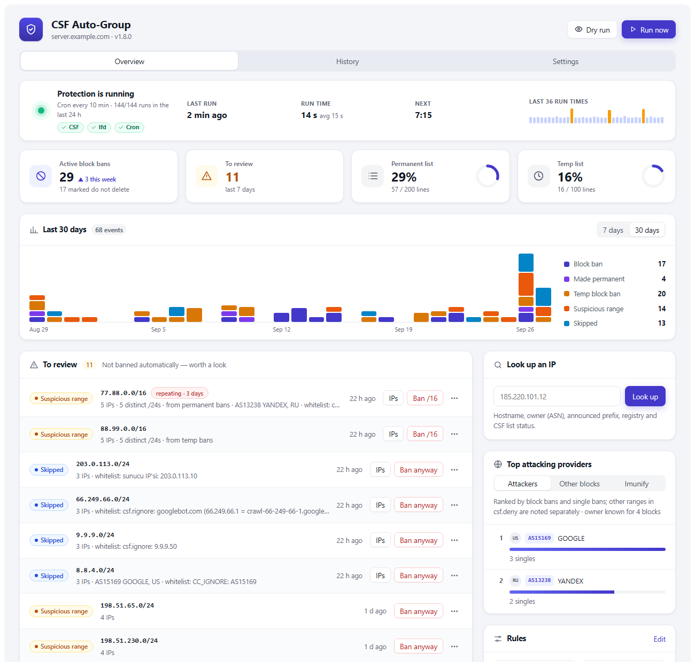
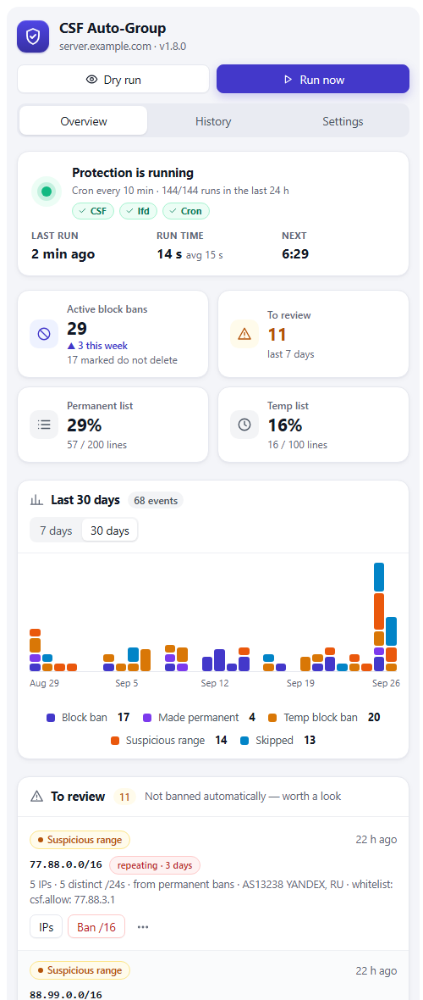
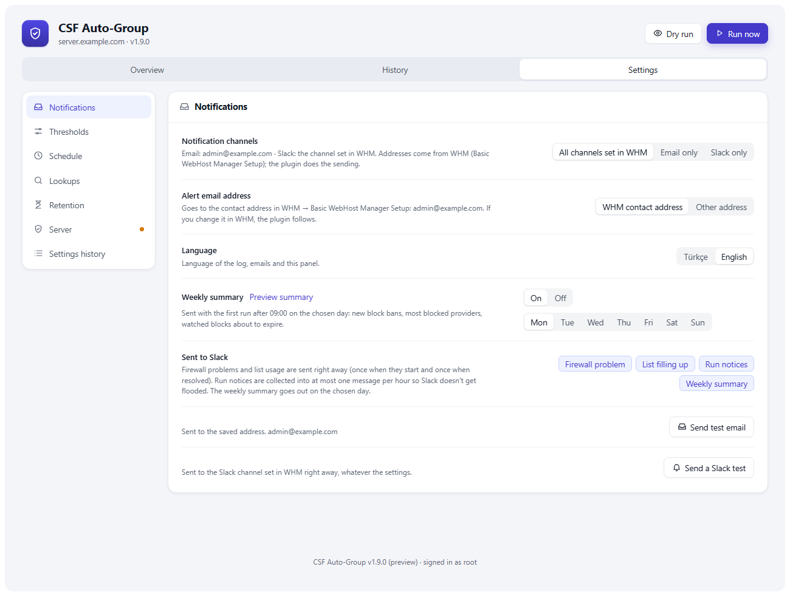
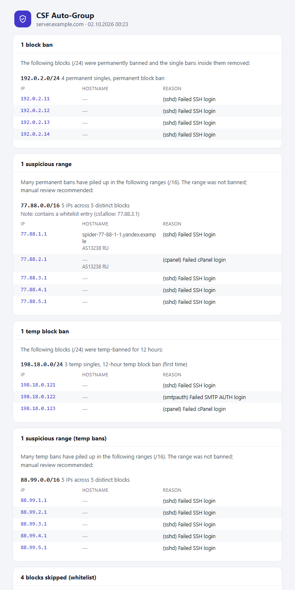

# CSF Auto-Group

**A WHM plugin for ConfigServer Security & Firewall (CSF)** that turns a
scatter of single-IP bans into subnet bans, and gives you one page to see
what your firewall is dealing with and act on it.

Most floods come from the same neighbourhood. When 3–5 already-banned IPs pile
up in a single `/24`, the rest of that range is almost always the same offender
still coming. CSF Auto-Group bans the **whole `/24`** and drops the singles, so
the violation is blocked before you have to touch anything. A range that comes back
is escalated to a **permanent** ban. `/16` networks are only flagged for review
(never auto-banned, too broad).



- **Automatic** — a cron job does the grouping every few minutes; the plugin is
  where you watch it and step in.
- **Who is it?** — every block and IP comes with its owner (ASN, organisation,
  country) and hostname, in the page and in alert emails.
- **Safe by default** — never bans a range that touches any CSF whitelist, and
  every manual action asks for confirmation.
- **Email and Slack** — one HTML email per run with everything it did (block
  bans, suspicious networks, skips, limit and firewall alerts), plus Slack
  messages. Both addresses come from WHM; nothing arrives twice.
- **Watches the firewall itself** — shows whether CSF and LFD are working and
  alerts you if one of them stops.
- **English / Türkçe** — the plugin, logs and emails.
- **Works on phones** — the page adapts to small screens.

**Version 1.11.0** ([changelog](CHANGELOG.md), [roadmap](ROADMAP.md)) · root-only WHM plugin on cPanel servers. On servers without
cPanel the same engine runs from cron and the command line
([details](#without-cpanel)).

**Terms used everywhere** (plugin, emails, log): a *single* is one banned IP, a
*block* is a `/24` (banned automatically), a *network* is a `/16` (never banned,
only flagged as *suspicious*), a *provider* is an ASN.

---

## ⚠️ Read this first

CSF Auto-Group **modifies your firewall**: it bans entire `/24` subnets (256
addresses). A threshold that's too low, or a legitimate visitor whose IP falls in
a banned `/24`, can lock people out.

- **Whitelist your own IPs** in `/etc/csf/csf.allow` (CSF allow overrides deny).
  A `/24` that touches any CSF whitelist is never banned; see
  [Whitelists](#whitelists).
- **Start with high thresholds** and watch the page (or
  `/var/log/csf_autogroup.log`) for a few days before trusting it. *Try before
  saving* in the Settings tab shows what new thresholds would do.
- `/16` is warn-only by design; only `/24`s are auto-banned.

## Install

```bash
git clone https://github.com/ayzeta/csf-autogroup.git
cd csf-autogroup
sudo bash install.sh
```

The installer asks for the language (`en`/`tr`), alert email (`whm` = the
contact address set in WHM, the default) and cron interval,
writes `config.env`, installs the root cron job and, on cPanel, the plugin under
**WHM → Plugins → CSF Auto-Group**. Re-run it any time.

Only `root` and WHM accounts with the `all` privilege can open the plugin.
Resellers can't.

## Updating

When GitHub has a newer version, the plugin shows a banner: **Update** runs
`update.sh` and **Reload page** loads the new version. The page checks on its
own every half hour while it is open; opening **Settings → Server** asks
GitHub again if the last answer is older than two minutes, and **Check for
updates** asks right away. The weekly summary email also mentions a new
version. From SSH:

```bash
cd csf-autogroup
sudo bash update.sh
```

`update.sh` pulls **only if GitHub is ahead**, then reinstalls with your saved
settings, with no prompts. `config.env` is left untouched.

## The plugin



### Overview

- **Status** — whether protection is running, when the last run was and how long
  it took, a countdown to the next run and the durations of the last 36 runs,
  plus three markers: **CSF** (rules loaded, not disabled, not in testing mode),
  **LFD** (running) and **Cron** (runs on time). Turns red when any of them has
  a problem.
- **Period** — 7 or 30 days, for the summary cards and the activity chart
  together.
- **Summary cards** — active block bans, items to review, and how full CSF's
  permanent and temp lists are, each with its change over the chosen period.
- **Activity** — a daily chart of block bans, blocks made permanent, temp block
  bans, suspicious networks and whitelist skips. Hover a day for its breakdown.
- **Colors** — one meaning, one color everywhere (badges, icons, chart): red full
  ban, violet made permanent, teal temp ban, blue partial ban, amber suspicious
  network, gray whitelist skip.
- **To review** — suspicious networks and whitelist-skipped blocks from the last 7
  days, as a table: why it was flagged (how many IPs hit which services),
  owner, when, and the narrowest ban that would do; clicking the IP count lists
  every IP's hostname, owner and ban reason. A range whose violations a provider ban
  or rented-server list already closes is left out. A network flagged on 3 or
  more separate days is marked *repeating* and moves to the top.
  It also lists offending IPs lfd can not stop, read from the lfd logs of the last
  7 days: an address in `csf.allow` is still banned by lfd (with CSF's default
  `IGNORE_ALLOW = "0"`) but the ban does not work (*Ban not working*); with
  `IGNORE_ALLOW = "1"`, or in `csf.ignore` / `csf.rignore`, lfd does not ban it
  at all (*Ignored*; CSF refuses to ban an ignored address on its own, but a ban
  on its block cuts it). Each row names the allow or ignore entry behind it,
  with the comment you wrote on that line (`1.2.3.4 # office`); an ignore that
  lfd took from `CC_IGNORE`, `RELAYHOSTS` or a reverse-DNS match in
  `csf.rignore` is traced the way lfd traces it. Failed logins coming from the
  server's own address (lfd never bans those) show as *Server's IP*, with
  the mail accounts that tried wrong passwords from inside the server when the
  mail log shows them. Several
  offending IPs from one allow entry, block or network are grouped like normal bans.
  A partial ban whose open services keep being hit shows as *Open service*.
- **Active range bans** — a sortable, paged table with each block's owner,
  searchable by CIDR, AS number or organisation. Filters show their counts.
  Blocks that became permanent on a second violation are tagged *repeat
  offender*; temp block bans show their time left. **⋯ → IPs** lists the IPs
  and ban reasons behind any block (from the event log). The
  *Old* filter lists block bans older than the old-block limit (default 365
  days), with a button to remove them all.
- **Watched** — `/24`s that were temp-banned once. If one comes back, it becomes
  permanent + `do not delete`. Sorted by days left; **⋯ → IPs** shows the IPs
  and reasons behind the temp block ban.
- **History** (its own tab) — every ban, promotion, skip, warning and manual
  action, and once a day the review list's findings that are otherwise
  recomputed from the logs (violations from allowed IPs, open services), so
  they stay after the review row is gone; back to the start of the event log:
  the latest 300 load first and
  **Show more** pages further back. Work from before the event log existed is
  filled in from the log. Click an address to open its IP card, or a range
  (/16, /24) to open its range card: whether the range itself is banned, which
  services hit are still open for it, and the bans inside it.
  Settings changes are listed under Settings → Settings history.
- **Suggestions where decisions are made** — the ban window suggests a partial
  ban when violations hit only one or two services; the remove window shows when
  and why the ban was added (and, for partial bans, violations on other services
  since then); the IP card shows how far the block is from its threshold;
  changing a threshold shows its effect on the current entries; suspicious
  networks show the services hit and suggest a single block when most
  singles sit in one.
- **History actions** — every row has a **⋯** menu with what can be done with
  that item *now* (ban, change, remove, ignore, show in Overview, IP card), and
  the newest row of each item says its current state ("banned now", "in To
  review", "no longer banned").
- **Look up an IP** — hostname (forward-confirmed), owner, announced prefix,
  registry, and **every** level at which CSF blocks it: the single ban, the
  covering `/24`, `/16` or other range (with its state, date and main ban
  reason), port-limited `csf.deny` rules for that address, and `CC_DENY` /
  `CC_DENY_PORTS` when its country or ASN is listed there. Also which list
  whitelists it (port-only `csf.allow` rules are shown with their ports), with
  links to bgp.he.net and AbuseIPDB, and buttons to ban its `/24` or `/16`.
  Recently viewed IPs stay one click away.
- **Inside a wider ban** — a block inside a banned `/16` (or any wider range) is
  tagged *inside /16* in Active range bans and Watched, and listed under
  *Bans no longer needed* in the Providers tab.
- **Ban announced range** — when the range the IP's owner announces is between
  /17 and /23, the IP card offers to ban just that range instead of the /16;
  a suspicious network whose IPs mostly sit in one such range offers it too.
- **Most blocked providers** (by ASN) — three tabs:
  - *Violations* — ranked by block bans and single bans, with each provider's most
    common ban reason, the services hit (web, mail, SSH…) with their
    counts, and when the last violation was. A provider with 5+ block bans gets a suggestion to add
    it to the provider ban. A provider partly inside a rented-server list is
    tagged with how much of it is already closed there.
  - *Added by hand* — ranges in `csf.deny` added outside CSF Auto-Group.
  - *Imunify360* (only with Imunify360) — providers in Imunify360's **own** block
    list on this server, with the block reasons. Read-only.
- **Banned providers** — its own card below: providers closed by a provider
  ban or fully covered by a rented-server list, with how they are closed and
  whether CSF has loaded their ranges; they are left out of the rankings above
  (and the weekly summary's). A provider banned with the port list only comes
  back to *Violations* while violations continue on services that list leaves open.

  Each list shows the first 5 with the total in its header; *More* and
  *Show all* open the rest, *Collapse* closes them again.
- **Terms** (header button) — a short glossary of the words the panel uses
  (single, block, watched, partial, provider ban, rented servers…).
- **Since your last visit** — what happened since you last opened the page; new
  rows carry a dot.

### Actions

Every action asks for confirmation. Risky ones (banning a `/16`, overriding a
whitelist, removing a `do not delete` block) make you type the target.

Manual bans run the same whitelist checks as automatic ones (for a `/16`, the
blocks inside with single bans are checked too), including Imunify360's own
whitelist. Manual `/24` and `/16` bans open the same window: it first lists what is inside
the range (CSF Auto-Group block bans, single bans, temp bans, watched blocks,
other ranges and port-limited rules), shows any whitelist overlap, and offers
**Remove covered entries** (on by default): every permanent entry inside the
range (block bans, single bans, other ranges, `do not delete` ones included)
leaves the permanent list and the temp bans leave the temp list; the window
shows how many lines each list frees and what happens to each row. Watching
ends for blocks inside either way; port-limited rules are left alone. The
removed permanent entries are saved: when you later remove the ban, **Restore
the N entries removed when this ban was added** puts them back exactly as they
were (comments, dates and `do not delete` markers). Temp bans are not restored,
they would have expired anyway. The removed IPs and their ban reasons also stay
with the new ban (**⋯ → IPs**). A range containing one of this server's own IPs
can't be banned at all.

**What to block** — the same window lets you choose:

- **Everything** — the range is cut in both directions (a normal CSF ban).
- **Selected services** — only connections *from* the range to the services you
  pick are blocked (Web, SSH on this server's real SSH port, FTP, cPanel · WHM ·
  Webmail, incoming mail, mail sync, DNS, plus any other ports or ranges such as
  `8080, 30000-35000`). Everything else stays open, and connections from this
  server to the range are not affected. Web includes UDP 443 (HTTP/3) and DNS
  includes UDP 53. It is one `csf.deny` line (split per 15
  ports), shown as *partial* in Active range bans; it doesn't cover the range, so
  nothing inside is removed and watching continues.
- **Everything except** — a full ban, but the services you pick stay open,
  including outgoing mail and outgoing web (this server calling APIs, backups or
  updates in that range). CSF checks bans before "established connection" replies,
  so each service gets a two-way allow rule in `csf.allow` (request and reply);
  for FTP the passive port range is added too (read from pure-ftpd / proftpd, or
  CSF's `TCP_IN`). The rules are marked and removed with the ban, and are never
  counted as whitelist entries.

Each service button shows how many IPs of the range hit it, read from the
ban reasons LFD wrote (`(sshd)` → SSH, `(smtpauth)` / `(imapd)` → mail sync,
ModSecurity and web rules → Web, port scans → "Everything" is suggested).
**Selected services** preselects only the services hit; **Everything
except** preselects nothing and warns when an service hit is kept open.
A **Blocked / Stays open** summary under the choices says in plain words what
the selection does. The window also points out services that depend on each other: mail may need DNS when
this server also hosts the DNS for its domains (other mail servers look up MX,
SPF, DKIM and DMARC records), web may need DNS for crawlers and visitors that
resolve through resolvers in that range, and cPanel addresses like
`cpanel.example.com` go through the web port. **⋯ → Change ban** reopens the
window for a CSF Auto-Group ban with its current choice: change the open
services, switch a full ban to a partial one (the entries it removed are
restored, since a partial ban doesn't cover the range) or a partial ban to a
full one.

| Button | Does |
|--------|------|
| Ban network (/16) | permanent `/16` ban, added as `do not delete`: from To review, **⋯** in Active range bans and Watched, and the IP card |
| Ban block (/24) | permanent `/24` ban from the IP card |
| Change ban | change what a CSF Auto-Group ban blocks (everything / selected services / everything except) |
| Ban anyway | ban a whitelist-skipped `/24` (overrides the whitelist) |
| Make permanent | make a watched `/24` permanent right away |
| Stop watching | forget a watched `/24` (next violation counts as the first) |
| Restart watch | start a watched `/24`'s watch period again from today (**⋯** in Watched and the IP card) |
| Remove | lift a block ban (`do not delete` blocks too; `csf.deny` is backed up first) |
| Remove old ones | on the *Old* filter: remove every block ban older than the old-block limit |
| Ignore | hide an item from review for 7/30/90 days or indefinitely (stops `/16` warning emails too), from a To review row's **⋯** or the IP card; change the duration or undo under *Ignored*, undo from the IP card too |
| IPs | a block's IPs and ban reasons, as recorded in the event log |
| Dry run | show what a run would do; changes nothing, sends nothing |
| Run now | run immediately instead of waiting for cron |

Manual actions are logged as `MANUAL (user): …` and appear on the History tab.

### Settings

The same settings as `config.env`, with validation, grouped into sections
(notifications, ban rules, running, sources and refresh, old bans, records,
server, settings history); related settings sit under small headings inside
each section:

- **Notifications** — channels: *all channels set in WHM* (default: email +
  Slack), *email only* or *Slack only*. Both addresses come from WHM: the
  contact email in Basic WebHost Manager Setup (or any other address you type)
  and the Slack address set there, which is read at send time and never stored
  by the plugin. The plugin sends the HTML emails and Slack messages itself, so
  nothing arrives twice. Choose which events go to Slack (firewall problem,
  list filling up, run notices, weekly summary): urgent ones go right away,
  run notices are collected into at most one Slack message per hour. *Send test
  email*, *Send a Slack test*, language, and the **weekly summary**: new block
  bans, providers CSF and Imunify360 block most, watched blocks about to
  expire, list usage, run health, and a note when a new version is available.
  Sent with the first run after 09:00 on the chosen day (default Monday).



- **Ban rules** — block ban (`/24`): permanent singles needed, the count that
  makes it *kept* (`do not delete`) and the temp block ban; suspicious network
  (`/16`, permanent and temp single bans counted together); the watch period
  (a temp-banned block that comes back within it is banned for good).
- **Running** — pause / run, and how often the cron run starts (every 5 / 10 /
  15 / 30 minutes or hourly).
- **Sources and refresh** — owner/hostname lookups on or off, DNS timeout and
  how long a block's owner is kept before it is looked up again (default 30
  days); how often the rented-server and allowed-service lists are downloaded
  again and after how many failed days it is reported; how old CSF's ASN data
  may get; how often Imunify360's list is read (default 60 minutes). The
  Providers cards link here.
- **Ban rules → Old bans** — old-block limit (default 365 days), how recent an attempt
  keeps a block from being old (default 30 days), and whether old block bans
  are removed automatically (default off; manual bans are never touched).
  Old-block removal keeps blocks marked "do not delete" and blocks still being
  tried: a banned block's traffic never reaches lfd, so the plugin counts it
  itself — an `ag_hits` ipset with a counter per banned range and one rule at
  the very top of the `mangle` table's `PREROUTING` that only counts (it
  neither blocks nor allows anything). It sits ahead of the rented-server list
  and the ban guard, so attempts they drop are counted too. CSF clears the
  counters on every reload: the plugin reads them before its own reloads, and
  `csfpost.sh` puts the rule back afterwards. Its last attempt shows in the
  state tip.
- **Running → records** — how long entries stay in *Needs review*, and the log file. The
  log is rotated by the system's logrotate (`/etc/logrotate.d/csf_autogroup`,
  written from these settings; default 1 MB, 5 compressed archives); where
  logrotate is missing, a log line limit is used instead. A run where nothing
  happened leaves a single line in the log.

A **Server requirements** card lists the tools CSF Auto-Group uses (CSF, cron,
mail, dig/host, logrotate, flock, timeout, git, Imunify360, ModSecurity hit log,
sqlite3) and what happens when one of them is missing.

*Try before saving* runs a dry run with the unsaved thresholds. Saving writes
`config.env` (previous file kept as `config.env.bak`), updates the crontab and
logs each change as `SETTING (user): KEY: old → new`. CSF's own list limits
(`DENY_IP_LIMIT`, `DENY_TEMP_IP_LIMIT`) are shown read-only with how full each list is; change them in CSF.

## How grouping works

The escalation ladder: a few bad singles in a block turn into a block ban, and a
block that comes back turns into a permanent one.

| Trigger | Action |
|--------|--------|
| `/24` with **≥3** permanent single bans | permanently ban the `/24`, remove the singles |
| `/24` with **≥5** permanent singles | ban `/24` + `do not delete` |
| `/16` with **≥5** singles across **≥2** `/24`s (permanent and temp counted together, each IP once) | flag as suspicious network by email, no auto-ban; reported again only when a new IP comes in (at most once a day). With a partial ban on the network, only bans after it count |
| `/24` with **≥3** temp bans (first time) | temp-ban the `/24` for 12h, watch it |
| same `/24` seen again (temp bans or permanent singles while watched) | permanent ban + `do not delete` |
| plugin's block ban left `csf.deny` without the plugin (CSF drops the oldest unmarked lines when `DENY_IP_LIMIT` is reached) | watch the `/24`, alert by email and in History |
| deny list **≥80%** of its limit | alert: email once a day; Slack once when it starts and once when resolved |
| CSF disabled / in testing mode / rules not loaded, or LFD not running | alert: email once a day; Slack once when it starts and once when resolved |
| block ban older than the old-block limit (optional) | remove it |

Temp bans already covered by a permanent block are cleared, watch records expire
after 180 days (configurable), and the log is capped. Singles marked
`do not delete` are never removed. A `/24` already covered by a broader block in
`csf.deny` (a `/22`, `/16`, …) is left alone. Folding singles into ranges also
keeps `csf.deny` from overflowing its line limit.

### Owner info

Each run sends at most one email; its subject sums up the run, e.g.
`CSF Auto-Group: 2 block bans · 1 suspicious network · 1 temp block ban`. Emails
are HTML (cards and tables that also work in desktop Outlook) with a plain-text
part for clients that don't show HTML.



The plain-text part looks like this:

```
185.220.101.0/24 -> 4 permanent singles, permanent block ban
   Owner: AS60729 ARTIKEL10, DE
   - 185.220.101.12   berlin01.tor-exit.artikel10.org  (sshd) Failed SSH login
   - 185.220.101.47   tor-exit-47.artikel10.org  (smtpauth) Failed SMTP AUTH login
```

- **Owner** — ASN, organisation and country, from
  [Team Cymru's](https://www.team-cymru.com/ip-asn-mapping) free DNS service (no
  account or API key). Cached for 30 days.
- **Hostname** — each IP's reverse DNS.
- **Reason** — why LFD banned it, from the ban's own comment. ModSecurity bans
  show the rule's message (e.g. `ModSecurity 1302: WP LOGIN VIEW RATE LIMIT…`),
  read from cPanel's ModSecurity hit log with `sqlite3`, or from the rule file
  named in the ModSecurity log when that isn't available.

Lookups are plain DNS queries (`dig` or `host`) with a short timeout. Set
`LOOKUP=0` to turn them off. Alert emails end with a link to the plugin
(`https://server:2087/ → Plugins → CSF Auto-Group`).

### Whitelists

Before banning a `/24` (permanent or temp), CSF Auto-Group checks it against
every list CSF uses to say "don't block this". If **any** entry overlaps the
`/24`, nothing is banned and you get one email a day naming the entry:

| Source | What is checked |
|--------|-----------------|
| `csf.allow` (+ `Include`) | IPs, CIDRs, hostnames, and port-only rules (`tcp\|in\|d=2083\|s=IP`) for a specific address or range; rules that open a port to everyone (`s=0.0.0.0/0`, anything wider than `/8`) are port rules, not whitelist entries |
| `csf.ignore` (+ `Include`) | IPs and CIDRs |
| `GLOBAL_ALLOW`, `GLOBAL_IGNORE`, `DYNDNS`, temp allows (`csf -ta`) | CSF's cached lists in `/var/lib/csf` |
| Server's own IPs | a `/24` containing one of this server's addresses |
| `CC_IGNORE`, `CC_ALLOW` in `csf.conf` | the block's country code or `ASnnnn` |
| `csf.rignore` | a banned IP whose reverse DNS matches (forward-confirmed, like LFD) |
| Imunify360 whitelist (only with Imunify360) | the server's local whitelist: manual entries and search engine bots Imunify whitelisted; expired entries are ignored, refreshed hourly |

This matters most for `csf.ignore`: CSF lets `csf.allow` addresses through even
inside a banned range, but `csf.ignore` only stops LFD, so a `/24` ban would
block those addresses. If a check can't be completed because DNS isn't
answering, the block is retried on the next run instead of being banned.

### With Imunify360

Imunify360 puts its own chain at the top of `INPUT`. For addresses on its grey,
splash-screen or captcha lists it redirects web and cPanel traffic (80, 443,
2082–2096) to its WebShield ports and accepts it before CSF's rules. Bans that
look at the port then no longer match, because the connection now goes to
52223/52224. These are the partial bans (web only), provider and country bans
with the port list (`CC_DENY_PORTS`), and the rented-server lists. A banned
address that passes the WebShield check (a real browser does) could still open
the sites. Full bans (single IPs, blocks, "everything") are not affected: CSF
applies them in both directions and Imunify360 only accepts a connection's
first packet.

The plugin closes this with one chain in the `mangle` table's `PREROUTING`
(`AG_GUARD`, `tools/ban-guard.sh`). That table runs before any redirect, so
the connection still carries the port it was sent to, and Imunify360 has no
rules there to race with (it puts its `INPUT` chain back on top within a
minute, so a rule in `INPUT` loses its place). For new incoming connections
only, it applies CSF's allow list first (the same list as the rented-server
rule: a single-port allow passes only on its port) and then the port bans. Other traffic
and this server's own outgoing connections are not touched. A `csfpost.sh`
line puts it back when CSF restarts, and each run checks that it is still
first. The rented-server lists use the same place (see below).

`bash tools/ban-leak.sh [HOURS]` (read only) checks the web logs of the last
24 hours, or the hours given, for requests that reached the sites while a ban
was in force, layer by layer. Allowed addresses are left out. It also lists the
rules that rewrite or accept traffic before CSF, and the banned addresses that
sit inside an allow list (those bans have no effect). Requests to sites behind
a CDN are listed separately, not as leaks: the firewall sees the CDN, not the
visitor. The report is also saved to `/root/ban-leak-DATE.txt`.

**Sites behind a CDN.** When a site's domain or its www name points to a CDN
(QUIC.cloud, Cloudflare…) or another address instead of this server, its
visitors reach the firewall through the CDN, so a CSF ban can not cut them; the
place to block them is the CDN's panel. `tools/cdn-sites.sh` finds these sites
once a day by DNS (the plugin runs it; `--show` lists them). The web logs don't
say which name a request came to, so if one of a site's names goes through a
CDN, that site's requests are treated as possibly behind it.

## Without cPanel

CSF Auto-Group works on any CSF server. Without cPanel there is no plugin page;
the cron job does the same grouping and sends the same emails, and everything
the page shows is available from the command line:

```bash
./csf_autogroup.sh --status          # same data as the plugin page
./csf_autogroup.sh --dry-run         # what a run would do, changes nothing
./csf_autogroup.sh --lookup 1.2.3.4  # who is this IP?
./csf_autogroup.sh --inside 1.2.0.0/16   # what a manual /16 (or /24) ban would cover
./csf_autogroup.sh --events latest 0 50   # the latest 50 events as JSON (after|before TIME N pages)
./csf_autogroup.sh --digest          # preview the weekly summary
./csf_autogroup.sh --config get      # current settings (--config set KEY=VALUE …)
./csf_autogroup.sh --help
```

Requirements: CSF and a working `sendmail` (HTML emails) or `mail` command
(plain text); `dig` or `host` for lookups. Optional: `sqlite3` (ModSecurity rule
messages in ban reasons) and `curl` (Slack).

### Manual install

```bash
cp config.env.example config.env      # edit ALERT_MAIL, MSG_LANG, thresholds
chmod 700 csf_autogroup.sh
( crontab -l 2>/dev/null; echo '*/10 * * * * /path/to/csf_autogroup.sh >/dev/null 2>&1' ) | crontab -
```

## Configuration

All settings live in `config.env` next to the script (see
[`config.env.example`](config.env.example)) and can be edited from the Settings
tab. Key options:

- `MSG_LANG` — `en` or `tr` (plugin, logs, emails and `csf.deny` comments).
- `ALERT_MAIL` — where alert emails go: `whm` (the contact address set in WHM,
  default) or an email address.
- `NOTIFY` — `all` (email + Slack, default), `email` or `slack`.
- `IC_FIREWALL`, `IC_LISTFULL`, `IC_RUN`, `IC_DIGEST` — which events go to Slack;
  `SLACK_BATCH_MIN` — run notices go to Slack at most this often (default 60).
- `THRESHOLD_24`, `THRESHOLD_24_PERMANENT`, `THRESHOLD_16`, `THRESHOLD_TEMP_24` —
  sensitivity.
- `LOOKUP`, `LOOKUP_TIMEOUT` — owner/hostname lookups.

## Uninstall

First turn off **Provider ban**, **Rented servers** and **Allowed services** in
the Providers tab and pause the plugin (Settings → Running): that removes what
the plugin added to CSF, including the block counter (`ag_hits`) and the ban
guard (`AG_GUARD`). Without the panel, `bash tools/block-hits.sh --remove` and
`bash tools/ban-guard.sh --remove` remove them.

```bash
crontab -l | grep -v 'csf_autogroup.sh' | crontab -
# WHM plugin (cPanel):
/usr/local/cpanel/bin/unregister_appconfig csf_autogroup
rm -rf /usr/local/cpanel/whostmgr/docroot/cgi/csf_autogroup /var/cpanel/csf_autogroup
rm -f /var/cpanel/apps/csf_autogroup.conf /usr/local/cpanel/whostmgr/docroot/addon_plugins/csf_autogroup.svg
rm -f /etc/logrotate.d/csf_autogroup
# optional:
rm -f /var/log/csf_autogroup.log
rm -rf /var/lib/csf_autogroup
```

Existing `/24` bans stay in `csf.deny` until you remove them (`csf -dr <cidr>`).

## Provider ban (experimental)

The **Providers** tab bans a whole provider by its AS number with CSF —
useful when violations come from one cloud spread over hundreds of networks, too
many to ban one by one. Everything is managed from the panel; the wanted state
is kept in `config.env`, and every run makes CSF match it. After a server move,
restoring `config.env` is enough.

- **What to block, per provider (up to 50):** *Port list* (`CC_DENY_PORTS`) or
  *Everything* (`CC_DENY` — this also breaks this server's connections to that
  provider, because CSF applies it before replies). CSF has a single port list
  for `CC_DENY_PORTS`, so it is shared: *Web only* (TCP 80, 443 and UDP 443 for
  HTTP/3) or *Selected ports*. If another country or provider there uses
  different ports, the list isn't changed and the screen says why.
- **Most blocked providers** sits next to it: **Ban…** on a row adds the
  provider to the list and measures its impact (nothing is applied until you
  save).
- **Measure impact** before saving: the last 24 hours of web logs, for that
  provider — response codes, successful requests, successful POSTs (payment
  notifications, webhooks), examples of failed requests (403, 404, 5xx…: code,
  site, request and an example IP) and non-browser clients, by site. Requests
  are split into sites behind a CDN (a ban does not affect them), allowed
  services, addresses an active rented-server list already closes, and the rest.
  For allowed services the responses they got are listed with the most
  frequent refused requests (which page gave Googlebot a 403, for instance);
  those come from the site or ModSecurity, not from a ban.
- After saving, the setting is written to CSF right away and lfd is restarted
  (lfd fills the address sets); the screen shows how many ranges are loaded.
  Turning it off removes only what the plugin added.
- **Needs review** leaves out a suspicious network when every offending IP is
  in a banned provider and the ban covers the service hit (a Web-only ban
  covers web violations, not SSH ones); no warning is sent for it.
- Block bans already inside a banned provider stay in `csf.deny`; they are
  marked *inside a provider ban* (checked against the ranges CSF loaded) and
  the Providers tab lists them under *Bans no longer needed* and can remove them.
- The weekly summary lists the banned providers, what is blocked and how many
  ranges CSF loaded.
- **CSF's ASN data:** lfd downloads `/var/lib/csf/Geo/ip2asn-combined.tsv` only
  when it is missing, so the addresses go stale; the plugin has lfd download it
  again when it is older than the period set in the card (default 25 days).
- A provider ban set up by hand in CSF is adopted the first time.
- This server's own provider is never banned.

**Allowed services.** Banning a provider also cuts the legitimate services
running there. Services that publish their own addresses can be allowed:
Google (Googlebot, AdsBot, Storebot, Gmail images, site verification), Bing,
Apple, DuckDuckGo, OpenAI, Stripe, Mollie, Microsoft 365 (Outlook, Exchange
Online) and the site monitors UptimeRobot, Pingdom and StatusCake, plus your own entries
(`name|https://list` or `name|IP`). They are written to a file included from
`csf.allow` (plain addresses, kept in an ipset); CSF checks the allow list
first, so they pass country and provider bans, on every port. Lists are
downloaded again as often as set under **Refresh** in the card (default every
day); a list that fails to download, or returns far fewer
addresses than before, keeps its previous version; ranges wider than /16 are
refused. Yandex and Facebook don't publish address lists.

Google and OpenAI publish several lists, one per kind of visitor; each shows as
a chip on its tile and can be switched off on its own. Google: crawlers
(Googlebot), special crawlers (AdsBot and the like), user-triggered fetchers
(site verification, feed readers) and Google's own fetchers. OpenAI: GPTBot
(training crawler), OAI-SearchBot (search) and ChatGPT-User (pages a user asks
for). **Exclusions** (`SVC_EXCEPT`) keep single addresses or ranges out of the
allowed lists even when a list contains them; the rest of the list stays
allowed. Use it when one address of a service keeps violating: a ban on an
allowed address has no effect, because CSF applies allows first. The IP card,
the review list and History offer this in one step for such an address.

The card shows when the lists were last downloaded and where each one comes
from; a built-in source's address can be changed there if the provider moves
it. A source that can't be downloaded for the warning period (default 3 days)
is reported (mail, Slack, Overview, History) until it works again. The rented-
server lists have the same two settings in their card.

`tools/services-allow.sh` does the downloading; the plugin runs it. It also
works by hand (`--check` shows what would change, `--remove` takes it out).

**Rented servers (experimental).** Cloud providers publish the addresses they
rent out to anyone (virtual servers); the Providers tab can block those on chosen ports
(default web): Google Cloud, AWS (EC2), Azure, Oracle Cloud, DigitalOcean,
Linode and Vultr. Unlike a provider ban, the providers' own services stay reachable — the
Google Cloud list has no Googlebot or Gmail. The lists go into an ipset with
one rule in the `mangle` table's `PREROUTING`, ahead of CSF and of
Imunify360: Imunify360 redirects greylisted addresses to its own WebShield
ports and accepts them before CSF's rules, so a rule in `INPUT` never saw that
traffic. `PREROUTING` runs before the redirect, so the rule sees the port the
connection was sent to. What CSF lets in passes here too
(`tools/allow-list.sh`, shared with the ban guard and the leak check):
addresses fully allowed in `csf.allow` (and the files it includes),
`GLOBAL_ALLOW`, DynDNS, temp allows and the allowed services pass on every
port; a single-port allow line (e.g. `tcp|in|d=22|s=…`) passes only on its
port. This server's own IPs are exempt; only new incoming connections are
dropped. Each run checks that the rule is still first and moves it back if
another tool put its own chain in front. A line in `csfpost.sh` puts the rule
back when CSF restarts (in `/usr/local/csf/bin/csfpost.sh` when that file
exists, since CSF then runs only that one). If a service you rely on runs in one of these clouds
and calls your sites, allow its address. `tools/cloud-ban.sh` does the work;
the plugin runs it.

Each list's download address can be changed from its tile (**Address**), and
**Extra lists** take your own `name|https://url` lists. Tiles also show how
many offending IPs from the event log fall in each list, selected or not.

## Development

`bash tests/durum-tablosu/calistir.sh` builds every ban state (single, temp,
watched, block and network bans — full and partial —, a range banned by another
source, a country ban, whitelist, warnings) in a throwaway root with stand-ins
for CSF and DNS, runs the engine on each, and prints which actions every panel
screen offers in that state. It checks them against a few rules: no ban that
would have no effect, the same label for the same action everywhere, and no
button that the ban dialog would then refuse. Needs bash and node; nothing is
written to the system.

`bash tests/hiz/calistir.sh` times the state the panel loads on opening
(`--status --json`) on generated server-sized data (1,500 bans, 450,000 lfd log
lines, 6,000 Imunify360 entries, banned providers with 3,000 ranges each) and
lists the slow parts; `SINIR=15` makes it fail above 15 seconds. Run it on
Linux for realistic times. On a server, `AG_PROF=1 csf_autogroup.sh --status
--json >/dev/null` prints the same breakdown for real data.

`bash tests/ayar-tutarliligi/calistir.sh` builds a sample value for every
setting the panel can send (from the engine's own source lists and default
addresses) and checks that both the panel's save check (`whm/api.php`) and the
engine's `--config set` accept it. Needs bash and php.

`bash tests/senaryo/calistir.sh` runs the engine's decisions against a scenario
matrix: each protection layer (provider ban with a port list or everything,
rented-server list, partial `/16` ban before or after the violations, allowed
services) × each violation type (web, mail, SSH, mixed, LFD PERMBLOCK) × timing,
and checks whether a suspicious network is hidden or shown, which services stay
open, and whether a block is banned or skipped. `bash tests/senaryo/siniflama.sh`
checks that the engine and the panel put the same lfd notes on the same service;
`bash tests/senaryo/birim.sh` checks small engine helpers on their own.
`bash tests/senaryo/gercek.sh` runs the same scenario matrix against a real
CSF/lfd in a local test VM (WSL2 with CSF installed): bans go into the real
`csf.deny` and are loaded with `csf -r`, rented-server lists are applied with
the real tool (ipset, rule, `csfpost.sh`), provider and country bans go into the
real `csf.conf`, owner lookups use real Team Cymru DNS. The VM's CSF files are
backed up first and restored after every scenario.
`bash tests/senaryo/kur-bulut.sh [cpanel-csf.rpm]` prepares a disposable
Debian/Ubuntu container (root, NET_ADMIN) for the same real-CSF run: it
installs cPanel's CSF from GitHub or from a given `cpanel-csf` package, stubs
the cPanel-only Perl modules, writes a test `csf.conf` and starts lfd; then
`GERCEK=1 bash tests/senaryo/calistir.sh` runs there. Never run it on a
server: it rewrites `csf.conf` and the firewall.

`bash tests/metin/calistir.sh` checks that every concept keeps one name in the
panel, mails and log: old or duplicate names listed in the script fail it.

`bash tests/arayuz/calistir.sh` opens the WHM pages themselves (index.php,
api.php, the real engine and the real CSF files, without WHM) in PHP's
built-in server and drives them with a headless Chromium (Playwright): every
tab at 1280 and 390 px with no horizontal overflow, no clipped badge and no
element past the right edge; the glossary; the IP card and the menu of every
Needs review row; and the Ignore → Ignored list → Stop ignoring flow end to
end. `GORUNTU=1` keeps screenshots in `tests/arayuz/cikti/`. Root, php, node
and the playwright module are needed; run it on the test VM or container, not
on a server.

## License

MIT — see [LICENSE](LICENSE).
